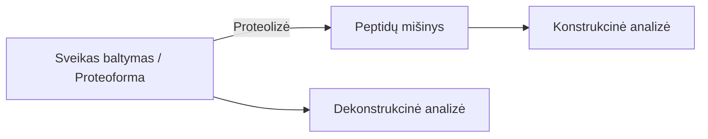
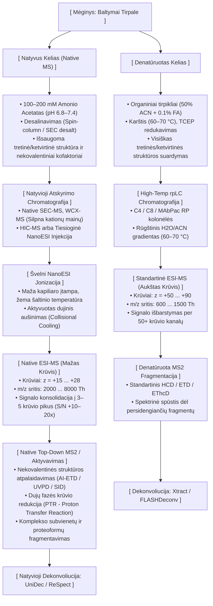

# Įvadas

Baltymo funkciją apibrėžia molekulės tridimensinė organizacija, kurią masių spektrometrija leidžia tirti visose keturiose struktūrinėse pakopose:

*   **Pirminė struktūra (Primary structure):** Aminorūgščių linijinė kovalentinė seka, po-transliacinės modifikacijos (PTM) ir disulfidiniai tilteliai.
    *   *MS taikymas:* Linijinės sekos patvirtinimas, PTM lokalizavimas bei disulfidinių jungčių kartografavimas naudojant fermentinį skaldymą arba intaktinių baltymų fragmentaciją.
*   **Antrinė struktūra (Secondary structure):** Lokaliai susidarančios $\alpha$-spiralės bei $\beta$-klostės, palaikomos polipeptidinio karkaso vandenilinių ryšių.
    *   *MS taikymas:* Vandenilio/deuterio mainų masių spektrometrija (HDX-MS), matuojanti karkaso amido vandenilių lankstumą ir apsaugą nuo tirpiklio.
*   **Tretinė struktūra (Tertiary structure):** Pilnas trimatis vienos polipeptidinės grandinės išsilankstymas erdvėje.
    *   *MS taikymas:* Kovalentinio žymėjimo (CL-MS / FPOP) bei kryžminio surišimo (XL-MS) metodai, nustatantys tirpikliui prieinamą paviršių (SASA) bei erdvinius atstumų ribojimus (*distance restraints*).
*   **Ketvirtinė struktūra (Quaternary structure):** Kelias polipeptidines grandines (subvienetus) jungiantys nekovalentiniai multimeriniai kompleksai.
    *   *MS taikymas:* Natyvioji masių spektrometrija (Native MS) bei jonų judrumo MS (IM-MS), išlaikanti nekovalentines sąveikas dujų fazėje ir nustatanti kompleksų stechiometriją bei topologiją.

**Potransliacinė modifikacija (PTM)** – tai bet koks kovalentinis baltymo cheminis pakitimas, vykstantis po to, kai jo priminė aminorūgščių grandinė būna susintetinta ribosomoje (transliacijos metu). PTM reiškinys išplečia genomo galimybes: iš vieno geno kodo sukuriama daugybė cheminiu bei funkciniu požiūriu besiskiriančių baltymo variantų – **proteoformų**. Šios modifikacijos keičia baltymo erdvinę struktūrą, stabilumą, katalizinį aktyvumą, sąveikas su kitomis molekulėmis bei išsidėstymą ląstelėje.

Priklausomai nuo tyrimo srities, dėmesys telkiamas į skirtingas PTM grupes:

##### **Potransliacinės modifikacijos biofarmacijoje**

Biofarmacijoje (gaminant vaistinius baltymus, monokloninius antikūnus ar vakcinas) po transliacinio modifikavimo reiškinys, bei pačios PTM suprantamos kaip **kritiniai kokybės atributai** (angl. *Critical Quality Attributes, CQAs*). PTM suprantamos kaip produkto degradacijos produktai gamybos, gryninimo, formulavimo ar saugojimo metu:

* **Glikozilinimas (Glycosylation):** Enzymatiškai pridedamos oligosacharidų grandinės prie asparagino (N-linked) arba serino/treonino (O-linked) liekanų. Glikozilinimas tiesiogiai veikia terapinių baltymų (pvz., IgG antikūnų, eritropoetino) tirpumą, pusperiodį serume, biologinį aktyvumą ir imuniteto atsaką.
* **Deamidinimas (Deamidation):** Nefermentinė reakcija, kurios metu asparaginas (Asn) arba glutaminas (Gln) paverčiami rūgštinėmis formomis (aspartatu/izoaspartatu arba glutamatu). Šį procesą skatina aukštesnė temperatūra, šarminis pH ir gretimos aminorūgštys (Gly, Ser, His). Deamidinimas keičia vaisto krūvį, struktūrinį stabilumą ir prisijungimo afinitetą.
* **Oksidacija (Oxidation):** Daugiausia metionino (Met) ir triptofano (Trp), taip pat cisteino, tirozino ir histidino pažeidimas dėl deguonies, šviesos ar pagalbinių medžiagų poveikio. Metionino oksidacija skatina baltymų agregaciją ir mažina efektyvumą.
* **N- ir C-terminaliniai nukirpimai bei modifikacijos:** N-galo glutamato ciklizacija į piroglutamatą (pGlu), C-terminalinio lizino praradimas (C-lysine truncation) bei peptidinio karkaso hidrolizinis fragmentavimas.
* **Disulfidinių jungčių persitvarkymas (Disulfide scrambling):** Neteisingas S–S ryšių susidarymas, redukcija ar nepageidaujama oksidacija, iškraipanti natyvią tretinę struktūrą ir sukelianti agregaciją.

Kritinių kokybės atributų labilūs židiniai (CQA hotspots) biofarmacijoje yra konkrečios aminorūgščių liekanos ar trimačio karkaso regionai vaistiniame baltyme (pvz., monokloniniame antikūne, mAb), kurie pasižymi **išskirtinai dideliu jautrumu neenziminėms cheminėms ar fizinėms degradacijos reakcijoms** gamybos, gryninimo, formulavimo ar saugojimo metu.

Ne visos baltymo aminorūgštys degraduoja vienodu greičiu. Labiliojo židinio (*hotspot*) susidarymą lemia **trijų veiksnių visuma**:

1. **Pirminė aminorūgščių seka (šoninių grandinių motyvai):**
   * Tam tikros aminorūgščių poros turi itin mažą sterinį kliuvinį ir didelį cheminį aktyvumą. Pavyzdžiui, **Asn-Gly (NG)** arba **Asp-Gly (DG)** motyvuose reakcijos vyksta **10–100 kartų greičiau** nei kitose sekoje esančiose vietose.
2. **Trimatė struktūra ir lankstumas (HOS / SASA):**
   * Lanksčiuose kilpų (*loops*) regionuose arba išoriniame baltymo paviršiuje pasiekiamos liekanos reaguoja daug sparčiau nei paslėptos hidrofobinėje baltymo šerdyje.
3. **Aplinkos sąveika (pH, temperatūra, šviesa, metalų jonai):**
   * Padidintas pH skatina deamidinimą, šviesa ir pėdsakiniai metalai – oksidaciją, o karštis – izomerizaciją.
   
| Židinio Tipas                                             | Jautriausi Motyvai / Vietos                             | Cheminis Mechanizmas ir Masės Poslinkis                                                                       | Poveikis Vaisto Savybėms (CQA)                                                                                              |
|:----------------------------------------------------------|:--------------------------------------------------------|:--------------------------------------------------------------------------------------------------------------|:----------------------------------------------------------------------------------------------------------------------------|
| **Asparagino Deamidinimas (Asn Deamidation)**             | **Asn-Gly (NG)**, Asn-Ser (NS), Asn-His (NH)            | Susidarant cikliniam **sukcinimidui**, Asn paverčiamas į Asp arba isoAsp (**$+0{,}984\text{ Da}$**).          | Įvedamas neigiamas krūvis, keičiasi izoelektrinis taškas (pI). Jei reiškiasi **CDR** srityje – krenta afiniškumas antigenui. |
| **Asparagino Rūgšties Izomerizacija (Asp Isomerization)** | **Asp-Gly (DG)**, Asp-Ser (DS)                          | Asp paverčiamas į **isoAsp** per sukcinimidinį tarpininką (**$+0\text{ Da}$**, bet keičiasi sulaikymas rpLC). | Peptidinio karkaso pailgėjimas per $-CH_2-$, keičiantis trimačio karkaso lankstumą ir biologinį  aktyvumą.                  |
| **Metionino Oksidacija (Met Oxidation)**                  | **Met252, Met428** (IgG1 Fc dalis), Met/Trp CDR srityje | Met paverčiamas į Met sulfoksidą (**$+15{,}995\text{ Da}$**) arba Met sulfoną (**$+31{,}99\text{ Da}$**).     | **Met252/Met428** oksidacija suardo sąveiką su **FcRn** receptoriumi – trumpėja vaisto pusperiodis kraujotakoje.            |
| **N-galinis Pyroglutamatas (PyroGlu)**                    | N-galinis **Gln** arba **Glu**                          | Spontaniška ciklizacija: Gln $\to$ pyroGlu (**$-17{,}027\text{ Da}$**, $-NH_3$).                              | Pašalinamas teigiamas N-galo krūvis, keičiasi pI ir elektroforezinis mobilumas.                                             |
| **C-galinio Lizino Nukirpimas (Lys Clipping)**            | C-galinė **Sunkioji grandinė (HC)**                     | Karboksipeptidazės pašalina C-galinį Lys (**$-128{,}09\text{ Da}$**).                                         | Įprastas charge-variant heterogeniškumas, būtinas stebėti partijų atkuriamumui.                                             |
| **N-Glikozilinimo Heterogeniškumas**                      | **Asn297** (Fc CH2 domenas)                             | G0F, G1F, G2F, Man5, Afukozilintos formos.                                                                    | Atsakingas už **ADCC / CDC** efektorines funkcijas bei imunogeniškumą.                                                      |

##### **Potransliacinės modifikacijos sistemų biologijoje**

Sistemų biologijoje PTM tyrinėjami siekiant suprasti **ląstelės signalinius tinklus**, genų raiškos reguliavimą, epigenetiką bei ligų patofiziologiją:

* **Fosforilinimas (Phosphorylation):** Fosfato grupės prijungimas prie Ser, Thr ar Tyr liekanų. Tai pagrindinis ląstelių signalizacijos jungiklis, keičiantis baltymų konformaciją, aktyvumą, lokalizaciją ir sąveikas ląstelės cikle bei signalo perdavimo takuose.
* **Ubikvitininimas (Ubiquitination) ir SUMOilinimas (SUMOylation):** Mažų baltyminių žymių kovalentinis prijungimas prie lizino liekanų, nukreipiantis baltymus proteasominiam skaidymui arba reguliuojantis jų atsaką į DNR pažaidas.
* **Acetilinimas ir metilinimas (Acetylation & Methylation):** Ypač aktualūs histonų modifikacijose, kur jie reguliuoja chromatinio pakavimą, genų transkripciją bei epigenetinį kodą.
* **S-tioliavimas (S-glutathionylation, S-cysteinylation):** Reaktyviųjų deguonies formų sukeliamos laisvų cisteino tiolio grupių modifikacijos, veikiančios kaip redokso būsenos jungikliai ir apsauga nuo oksidacinio streso.
* **Modifikacijų tarpusavio sąveika (PTM Crosstalk):** Reiškinys, kai viena modifikacija (pvz., fosforilinimas) skatina arba slopina kitą modifikaciją toje pačioje ar gretimose baltymo vietose, suformuojant sudėtingus ląstelinio atsako signalus.

# Masių spektrometrija struktūrinėje biologijoje

Masių spektrometriniai tyrimai skirstomi į dvi pagrindines metodologines kryptis, priklausomai nuo to, analitės būsenos patenkančios į masių spektrometrą:

| Parametras | **Konstrukcinė analizė (*Bottom-Up*)** | **Dekonstrukcinė analizė (*Top-Down*)** |
| :--- | :--- | :--- |
| **Principas** | Baltymas prieš analizę fermentiškai suskaidomas į trumpus peptidus (dažniausiai tripsinu). | Į masių spektrometrą įvedamas ir analizuojamas **sveikas, nesuskaldytas baltymas (proteoforma)**. |
| **Analitė MS analizatoriuje** | Peptidų mišinys (MS1) ir jų fragmentai (MS2). | Intaktinė proteoforma (MS1) ir jos dujų fazės fragmentai (MS2: HCD, ETD, UVPD). |
| **Privalumai** | <ul><li>Didelis jautrumas ir matavimo greitis.</li><li>Standartizuotas mėginio paruošimas ir chromatografija.</li><li>Brandūs bioinformatiniai paieškos algoritmai.</li></ul> | <ul><li>Išsaugomas pilnas PTM kontekstas ir deriniai (kombinatorinis PTM kodas).</li><li>Nėra baltymo inferencijos problemos (*no protein inference problem*).</li></ul> |
| **Trūkumai** | <ul><li>Prarandamas ryšys tarp tolimų modifikacijų.</li><li>Nepilnas sekos padengimas.</li></ul> | <ul><li>Mažesnis jautrumas dėl plataus krūvių pasiskirstymo.</li><li>Apribota baltymų mase (sudėtinga analizuoti >70 kDa).</li></ul> |

## Peptidų (ir baltymų) fragmentacijos principai

Peptido ar baltymo fragmentacija masių spektrometrijoje vyksta skeliant polipeptidinį karkasą dujų fazėje. Pagal tarptautinę **Biemann nomenklatūrą**, gauti fragmentai skirstomi į **N-terminalinius** ($a, b, c$) ir **C-terminalinius** ($x, y, z$) jonus, priklausomai nuo to, kuris peptido galas išlaiko krūvį po konkretaus karkaso ryšio skėlimo.

#### Peptidinio karkaso skėlimo vietos ir jonų struktūros

Polipeptido karkasą sudaro pasikartojanti aminorūgščių liekanų seka:

$$\dots \text{-- } \text{N-C}_\alpha \text{ -- } \text{C}_\alpha\text{-C(=O)} \text{ -- } \text{C(=O)-N(H)} \text{ -- } \text{C}_\alpha \text{ --}\dots$$

Kiekvienoje aminorūgšties liekanoje yra trys pagrindiniai karkaso kovalentiniai ryšiai, kuriuos skeliant susidaro atitinkamos jonų poros:

##### **$C_\alpha-C$ ryšio skėlimas $\rightarrow$ $a / x$ jonai**
* **$a$-jonas:** N-terminalinis fragmentas, pasibaigiantis $C_\alpha$ anglimi.
* **$x$-jonas:** C-terminalinis fragmentas, prasidedantis karbonilo grupe ($\text{O=C-}$).

##### **$C-N$ (peptidinio) ryšio skėlimas $\rightarrow$ $b / y$ jonai**
* **$b$-jonas:** N-terminalinis fragmentas, pasibaigiantis karbonilo grupe. Dujų fazėje dažnai suformuoja ciklinę **oksazolono** struktūrą.
* **$y$-jonas:** C-terminalinis fragmentas, prasidedantis laisva amino grupe ($\text{H}_2\text{N-}$), išlaikantis nepakitusį C-galą.

##### **$N-C_\alpha$ ryšio skėlimas $\rightarrow$ $c / z$ jonai**
* **$c$-jonas:** N-terminalinis fragmentas, pasibaigiantis amido grupe ($\text{-C(=O)-NH}_2$).
* **$z$-jonas:** C-terminalinis fragmentas, dažnai susidarantis kaip radikalas ($z^\bullet$), prasidedantis $C_\alpha$ anglimi.

#### Fragmentavimo metodai (HCD, ETD, UVPD) ir jonų specifiškumas

##### **HCD (Higher-energy Collisional Dissociation) $\rightarrow$ $b / y$ jonai**
* **Mechanizmas:** HCD yra **slenkstinės / vibracinės energijos metodas** (*ergodic activation*). Prekursoriaus jonai susiduria su inertinėmis dujomis (N₂, Ar), sukaupia internaliąją vibracinę energiją, kuri pasiskirsto po visą molekulę ir skelia termodinamiškai silpniausią karkaso ryšį – peptidinį **$C-N$ ryšį**.
* **Rezultatas:** Spektre dominuoja **$b$ ir $y$ jonų serijos**.
* **Ypatybė:** Dėl ergodinio energijos pasiskirstymo trapūs po-transliaciniai pakitimai (PTM, pvz., fosforilinimas) gali lengvai nukristi, o disulfidiniai tilteliai išlieka nesuskilę.

* **komentaras** Ergodinis procesas (pvz., HCD, CID): Molekulė sužadinama lėtai arba per daugkartinius susidūrimus su dujomis (vibracinis sužadinimas). Suteikta energija pasklinda po visą peptidinį karkasą3. Dėl to pirmiausia skyla termodinamiškai silpniausi ryšiai – dažniausiai nukrinta trapios po-transliacinės modifikacijos (PTM, pvz., fosfato grupės) arba suskyla mažiausios energijos reikalaujantis peptidinis $C-N$ ryšys ($b/y$ jonai)

##### **ETD (Electron Transfer Dissociation) $\rightarrow$ $c / z$ jonai**
* **Mechanizmas:** ETD yra **elektronais valdomas, neergodinis metodas**. Daugiakrūviai peptido katijonai reaguoja su mažos energijos reagentų anionais, perduodami elektroną. Šis procesas sukelia radikalinę reorientaciją, kuri specifiškai ir greitai skelia **$N-C_\alpha$ ryšį**.
* **Rezultatas:** Generuojami **$c$ ir $z^\bullet$ jonai**.
* **Ypatybė:** Kadangi fragmentacija įvyksta iki vibracinės energijos pasiskirstymo, labilios PTM ir nekovalentinės struktūros išlieka pažeistos minimaliai, todėl ETD idealiai tinka modifikacijų lokalizavimui.

* **komentaras** **Neergodinis procesas (pvz., ETD, ECD, iš dalies UVPD):** Atsiranda dėl tiesioginio elektronų pagavimo / pernašos arba aukštos energijos fotono absorbcijos[1]. Įvyksta žaibiška lokalizuota elektroninė pertvarka arba radikalo susidarymas, sukeliantis ryšio skėlimą dar iki energijos persiskirstymo po visą molekulę.

##### **UVPD (Ultraviolet Photodissociation) $\rightarrow$ $a / x$ (bei visas $a, b, c, x, y, z$ rinkinys)**
* **Mechanizmas:** UVPD metu jonai apšvitinami aukštos energijos UV fotonais (dažniausiai 193 nm arba 213 nm laserio impulsais). Elektronų sužadinimas sukelia greitą tiesioginį ryšių nutraukimą.
* **Rezultatas:** Pagrindinė būdinga jonų klasė yra **$a$ ir $x$ jonai**, tačiau UVPD sukuria itin turtingus spektrus, kuriuose stebimos **visos šešios fragmentų serijos ($a, b, c, x, y, z$)**.
* **Ypatybė:** Maža priklausomybė nuo krūvio būsenos ir labai didelis sekos padengimas (*sequence coverage*), tiriant tiek pavienius baltymus, tiek baltymų kompleksus.

| Jonų pora | Skeliamas karkaso ryšys | Fragmentavimo metodas | Metodo veikimo principas | Pagrindinis taikymas |
| :--- | :--- | :--- | :--- | :--- |
| **$b / y$** | **$C-N$** (peptidinis ryšys) | **HCD** / CID | Slenkstinis vibracinis sužadinimas per susidūrimus su dujomis | Standartinė peptidų ir proteomų seka (*bottom-up*) |
| **$c / z$** | **$N-C_\alpha$** ryšys | **ETD** / ECD | Elektronų pernaša / radikalo susidarymas (neergodinis) | PTM lokalizavimas ir intaktinių baltymų analizė (*top-down*) |
| **$a / x$** *(+ $b,c,y,z$)* | **$C_\alpha-C$** ryšys | **UVPD** (193 nm / 213 nm) | Elektroninis sužadinimas švitinant UV fotonais | Maksimalus sekos padengimas, baltymų kompleksai |

## Konstrukcinė (angl. bottom-up) analizė

Analizuojant baltymus masių spektrometrija, **„Konstrukcinė analizė“ (bottom-up)** principas yra labiausiai paplitusi strategija. Šiuo atveju sveikas baltymas yra chemiškai arba fermentiškai suskaldomas į mažesnius peptidus, kurie vėliau analizuojami naudojant skysčių chromatografiją, sujungtą su tandemine masių spektometrija (LC-MS/MS).

### Mėginio paruošimas.

Mėginio paruošimas nustato masių spektrometrijos analizės kokybės lubas: jis tiesiogiai lemia sekos padengimą (sequence coverage), peptidų jonizacijos efektyvumą ir leidžia išvengti dirbtinių cheminių modifikacijų susidarymo. Žemiau pateikiamas generinis gryno baltymo paruošimo protokolas su kiekvieno žingsnio paaiškinimu bei dažniausiai naudojamų proteazių aprašymu.

#### **Generinis bottom-up mėginio paruošimo protokolas**

##### **1. Denatūravimas (Denaturation)**
*   **Kas daroma:** Baltymas ištirpinamas suderinamame buferyje (pavyzdžiui, amonio bikarbonatinis arba Tris-HCl) ir paveikiamas stipriomis denatūruojančiomis medžiagomis – 8 M karbamidu (urea), guanidino hidrochloridu (guanidine-HCl), SDS arba masių spektrometrijai suderinamais plovikliais (pvz., RapiGest, SDC), kartais papildomai naudojant karštį.
*   **Svarba:** Šis žingsnis **išlanksto (unfolds) trimatę baltymo struktūrą**. Natūralioje būsenoje daugelis peptidinio karkaso ryšių yra paslėpti baltymo viduje. Denatūravimas padaro šiuos ryšius fiziškai prieinamus proteazei, o tai yra kritinis veiksnys siekiant maksimalaus virškinimo efektyvumo ir geros sekos aprėpties.

##### **2. Redukcija (Reduction)**
*   **Kas daroma:** Į tirpalą pridedama reduktorių, dažniausiai ditiotreitolio (DTT) arba tris(2-karboksietil)fosfino (TCEP), ir mėginys inkubuojamas (pvz., 30–60 min esant 30–60 °C temperatūrai).
*   **Svarba:** Redukavimas **suardo kovalentinius disulfidinius tiltelius (S–S ryšius)** tarp cisteino liekanų. Tai ypač svarbu disulfidais gausiai stabilizuotiems baltymams (pavyzdžiui, monokloniniams antikūnams), nes be šio žingsnio baltymas negali visiškai išsivynioti, o dalis sekos proteazei išlieka nepasiekiama.

##### **3. Alkilinimas (Alkylation)**
*   **Kas daroma:** Į redukuotą tirpalą pridedama alkilinimo agento, pavyzdžiui, jodacetamido (IAA/IAM) arba N-etilmaleimido (NEM). Reakcija vykdoma kambario temperatūroje, tamsoje, maždaug 20–60 minučių.
*   **Svarba:** Alkilavimas **kovališkai užblokuoja laisvas tiolio (-SH) grupes**. Jei šis žingsnis nebūtų atliktas, redukuoti cisteinai pH 7.5–8.5 terpėje greitai vėl suformuotų atsitiktinius disulfidinius ryšius – įvyktų disulfidų persitvarkymas (scrambling). Reakcija vykdoma tamsoje, siekiant išvengti šviesai jautraus jodacetamido skilimo ir su tuo susijusių pašalinių reakcijų. Taip pat būtina kontroliuoti alkilinimo agento koncentraciją, kad būtų išvengta nepageidaujamo kitų aminorūgščių (pvz., lizino) alkilinimo (over-alkylation).

##### **4. Buferio pakeitimas (Buffer Exchange / Dilution)**
*   **Kas daroma:** Prieš pridedant fermentą, denatūruojančių medžiagų koncentracija turi būti žymiai sumažinta. Pavyzdžiui, karbamido koncentracija turi būti mažesnė nei 2 M. Tai pasiekiama atskiedžiant mėginį virškinimo buferiu.
*   **Svarba:** Didelės denatūruojančių medžiagų koncentracijos **gali visiškai denatūruoti ir inhibuoti pačią proteazę**. Atskiedimas užtikrina optimalią aplinką proteazės aktyvumui išlaikyti.

##### **5. Fermentinis virškinimas (Enzymatic Digestion)**
*   **Kas daroma:** Įmaišoma proteazė (dažniausiai tripsinas). Įprastas fermento ir baltymo santykis svyruoja nuo $\text{1:10}$ iki $\text{1:100}$ (auksiniu standartu laikomas $\text{1:20}$ arba $\text{1:50}$). Mėginys inkubuojamas 37 °C temperatūroje tam tikrą laiką (paprastai 4–18 valandų arba per naktį). Reakcija sustabdoma parūgštinant mėginį iki pH < 3 (pridedant iki 1% skruzdžių rūgšties (HCOOH) arba trifluoracto rūgšties(TFA)).
*   **Svarba:** Proteazė **suskaldo ilgą baltymo grandinę į masių spektrometrui suderinamo dydžio peptidus** (paprastai 6–50 aminorūgščių). Virškinimo pH kontrolė yra itin svarbi: tripsinui tradiciškai naudojamas pH 8, tačiau naujesni tyrimai rodo, kad virškinimas esant pH 7 žymiai sumažina tripsino ar chimotripsinio  autolizę, be to išvengiant peptidų skilimo (dacay).

##### **6. Peptidų išvalymas ir nudruskinimas (Desalting / Cleanup)**
*   **Kas daroma:** Peptidų mišinys sulaikomas panaudojant atvirkščių fazių sorbentą (tipiškai C18). Sorbentas plaunamas vandeniu, ir peptidai eliuuojami daug organinio tirpiklio (tarkim ACN) turinčiu eliuentu. Tipiškai 80% ACN 20% 0.1%HCOOH vandenyje.
*   **Svarba:** Biolizės ir virškinimo metu naudotos nelakios druskos (pvz., NaCl, Tris), denatūrantai ir kiti reagentai stipriai slopina masių spektrometro elektropurškimo jonizacijos (ESI) signalą (ionization suppression). Nudruskinimas **pašalina tukdančias medžiagas**, palikdamas tik švarius peptidus lakiame, su masių spektrometrija suderinamame tirpiklyje.

#### **Dažniausiai naudojamos proteazės masių spektrometrijoje**

Masių spektrometrijoje proteazės pasirenkamos pagal jų kirpimo specifiškumą, aktyvumą buferiuose ir tirpumo savybes:

1.  **Tripsinas (Trypsin)**
    *   **Kirpimo vieta:** Specifiškai skelia peptidines jungtis C-terminalinėje pagrindinių aminorūgščių **lizino (Lys/K)** ir **arginino (Arg/R)** pusėje (jei po jų neseka prolinas).
    *   **Taikymas ir svarba:** Tai **dažniausiai naudojama proteazė** bottom-up proteomikoje. Tripsinas sugeneruoja optimalaus ilgio peptidus (vidutiniškai 14 aminorūgščių), kurie pasižymi teigiamu +2 krūviu teigiamos ESI masių spektrometrijos sąlygose (dėl C-terminalinio K/R ir N-terminus), o tai užtikrina puikų aptikimą ir lengvą fragmentaciją.

2.  **Lys-C**
    *   **Kirpimo vieta:** Specifiškai skelia tik po **lizino (Lys/K)** liekanų (gali skelti net jei po lizino seka prolinas).
    *   **Taikymas ir svarba:** Lys-C yra itin atsparus denatūrantams (gali išlaikyti aktyvumą net esant 2 M guanidino HCl). Dažnai naudojamas etapiniam (staged) arba kombinuotam virškinimui su tripsinu (Lys-C/trypsin), siekiant maksimaliai suvirškinti itin tankius, sunkiai prieinamus baltymus.

3.  **Asp-N**
    *   **Kirpimo vieta:** Specifiškai skelia N-terminalinėje pusėje prieš **aspartato (Asp/D)** (ir kartais glutamato (Glu/E)) liekanas.
    *   **Taikymas ir svarba:** Naudojamas kaip papildomas fermentas tripsino „aklosioms dėmėms“ padengti arba analizuojant specifines modifikacijas (pavyzdžiui, glikozilinimą ar vaistų prisijungimo vietas biopreparatuose).

4.  **Pepsinas (Pepsin)**
    *   **Kirpimo vieta:** Pasižymi platesniu, nespecifiniu kirpimu (daugiausia po hidrofobinių ir aromatinių liekanų).
    *   **Taikymas ir svarba:** Pepsinas yra išskirtinis tuo, kad **veikia itin rūgščioje terpėje (pH 1.3–2.5)**. Tai yra pagrindinis fermentas **vandenilio-deuterio mainų (HDX-MS)** tyrimuose, kur parūgštinimas ir žema temperatūra (gesinimo sąlygos) yra būtinos siekiant išvengti deuterio praradimo. Taip pat pepsinas plačiai taikomas disulfidinių tiltelių žemėlapių sudarymui, nes rūgštus pH užkerta kelią disulfidų persitvarkymui.

5.  **Chymotripsinas (Chymotrypsin)**
    *   **Kirpimo vieta:** Skelia C-terminalinėje **aromatinių ir hidrofobinių liekanų** – tirozino (Tyr/Y), fenilalanino (Phe/F), triptofano (Trp/W) bei, kiek lėčiau, leucino (Leu/L) ir metionino (Met/M) – pusėje.
    *   **Taikymas ir svarba:** Naudojamas kaip alternatyvus fermentas hidrofobinių membraninių baltymų sričių analizėje arba kai tripsinas sugeneruoja per didelius ar per mažus fragmentus.

### De-Novo peptidų sekvenavimas

#### Instrumentinė DDA analizė

**De Novo sekvenavimui** DDA (*Data-Dependent Acquisition*) parametrai optimizuojami vienam tikslui – gauti **kuo švaresnį, didelės skiriamosios gebos MS/MS spektrą su kiek įmanoma daugiau diagnostinių fragmementų**:

1. **Siauras izoliacijos langas (0.5–1.0 Da):** Užtikrina vieno prekursoriaus izoliavimą ir užkerta kelią chimerinių spektrų susidarymui.
2. **Didelė MS2 skiriamoji geba (60 000–120 000+) ir masės tikslumas (<10 ppm):** Būtini tiksliam izotopinių klasterių išskleidimui, krūvių nustatymui bei masių skirtumų skaičiavimui.
3. **Padidintas signalo akumuliavimas (aukštas AGC target ir Max Inject Time):** Pakelia signalo ir triukšmo santykį $S/N$, išryškindamas silpnus karkaso fragmentus.
4. **Aukštesnio krūvio atranka $z \ge +2$, optimalu $z \ge +3$:** Atrenkami geriau ir įvairiapusiškiau fragmentuojantys prekursoriai.
5. **Komplementarios fragmentacijos strategija (Stepped HCD, ETD/EThcD arba UVPD):** Generuoja kelias fragmentų serijas $b/y$, $c/z$, $a/x$, užpildančias sekos spragas.
6. **Trumpas dinaminio atmetimo sąrašo (DEW) galiojimas:** Leidžia taikyti pakartotinį skenavimą / spektrų vidurkinimą silpniems fragmentams sustiprinti.

#### Duomenų analizė

Tegul peptidas $P$ yra aminorūgščių liekanų seka iš $N$ elementų: $$P = [a_1, a_2, \dots, a_N]$$

Čia $m(aa_ri)$ yra $i$-osios aminorūgšties liekanos monoisotopinė masė ($a_i \in \mathcal{A}$, kur $\mathcal{A}$ – 20 standartinių aminorūgščių masių aibė).

Protono masė: $m(\text{H}^+) \approx 1{,}0073\ \text{Da}$

Vandens masė: $m(\text{H}_2\text{O}) \approx 18{,}0106\ \text{Da}$

Prekursoriaus jono masė ($M_{\text{prec}}$): 

$$M_{\text{prec}} = [M+\text{H}]^+ = \sum_{i=1}^N m(a_i) + m(\text{H}_2\text{O}) + m(\text{H}^+)$$

| Liekana       | Ilgas Žymuo | Trumpas Žymuo | Liekanos masė($\text{m(AA)}_{r}$) | $\text{b}_{1}$ jonas | $\text{y}_{1}$ jonas | $\text{b}_{n-1}$ jonas |
|---------------|-------------|---------------|-----------------------------------|----------------------|----------------------|------------------------|
| Alanine       | Ala         | A             | 71.0371                           | 72.0444              | 90.055               | 54.0338                |
| Cysteine      | Cys         | C             | 102.0014                          | 103.0086             | 121.0192             | 84.9981                |
| Asp.acid      | Asp         | D             | 115.0269                          | 116.0342             | 134.0448             | 98.0237                |
| Glu.acid      | Glu         | E             | 129.0426                          | 130.0499             | 148.0604             | 112.0393               |
| Phenylalanine | Phe         | F             | 147.0684                          | 148.0757             | 166.0863             | 130.0651               |
| Glycine       | Gly         | G             | 57.0215                           | 58.0287              | 76.0393              | 40.0182                |
| Histidine     | His         | H             | 137.0589                          | 138.0662             | 156.0768             | 120.0556               |
| Isoleucine    | Ile         | I             | 113.0841                          | 114.0913             | 132.1019             | 96.0808                |
| Lysine        | Lys         | K             | 128.095                           | 129.1022             | 147.1128             | 111.0917               |
| Leucine       | Leu         | L             | 113.0841                          | 114.0913             | 132.1019             | 96.0808                |
| Methionine    | Met         | M             | 131.0405                          | 132.0478             | 150.0583             | 114.0372               |
| Asparagine    | Asn         | N             | 114.0429                          | 115.0502             | 133.0608             | 97.0396                |
| Proline       | Pro         | P             | 97.0528                           | 98.06                | 116.0706             | 80.0495                |
| Glutamine     | Gln         | Q             | 128.0586                          | 129.0659             | 147.0764             | 111.0553               |
| Arginine      | Arg         | R             | 156.1011                          | 157.1084             | 175.119              | 139.0978               |
| Serine        | Ser         | S             | 87.032                            | 88.0393              | 106.0499             | 70.0287                |
| Threonine     | Thr         | T             | 101.0477                          | 102.055              | 120.0655             | 84.0444                |
| Valine        | Val         | V             | 99.0684                           | 100.0757             | 118.0863             | 82.0651                |
| Tryptophan    | Trp         | W             | 186.0793                          | 187.0866             | 205.0972             | 169.076                |
| Tyrosine      | Tyr         | Y             | 163.0633                          | 164.0706             | 182.0812             | 146.06                 |

#### Algoritmas 1: N-terminalinis sekvenavimas

Algoritmas atlieka paiešką masių spektro smailių rinkinyje $\mathcal{S} = \{m/z_1, m/z_2, \dots\}$, judėdamas nuo N-galo ($0\ m/z$) link prekursoriaus masės $M_{\text{prec}}$

##### Atskaitos taško nustatymas bei pirminių jonų ($b_1$ ir $y_1$) paieška

Atskaitos bazinė būsena ($b_0, y_0$): 

$$m/z(b_0) = m(\text{H}^+) \approx 1{,}0073\ \text{Da} \quad (\text{atitinka } 0\ \text{Da neutralioje skalėje})$$

$$m/z(y_0) = m(\text{H}_2\text{O}) + m(\text{H}^+) =  19{,}0224$$

###### $b_1$ jono paieška ir atitinkama seka: 

* **Matematinė sąlyga**: Ieškoma smailės $m/z \in \mathcal{S}$, tenkinančio lygtį:

$$m/z(b_1) = m/z(b_0) + m(AA_{r1}) \pm \varepsilon = m(\text{H}^+) + m(AA_{r1}) \pm \varepsilon$$ 

(kur $\varepsilon$ – spektrometro masių paklaida, pvz., ppm arba Da).
* **Atitinkanti seka**: $b_1$ jonas atitinka N-terminalinį monopeptidą $P_{1..1} = [a_1]$.

###### $y_1$ jono paieška ir atitinkama seka:
* **Matematinė sąlyga**: C-terminalinis pirminis fragmentas tenkina lygtį: 

$$m/z(y_1) = m(AA_{rN}) + m(\text{H}_2\text{O}) + m(\text{H}^+) \approx m(AA_{rN}) + 19{,}0224\ \text{Da}$$

(Tripsino proteolizės atveju $a_N \in \{\text{Lys}, \text{Arg}\}$, todėl $m/z(y_1) \in \{147{,}1129\ \text{Da}, 175{,}1190\ \text{Da}\}$).

* **Atitinkanti seka**: $y_1$ jonas atitinka C-terminalinį monopeptidą $P_{N..N} = [a_N]$.

##### Rekursinė jonų serijų paieška ($b_k$ ir $y_k$)

Žinant $(k-1)$-ąją būseną, $k$-ojo jono paieška vykdoma pagal rekursines priklausomybes:

######  $b_k$ jonų serijos auginimas ($N \rightarrow C$ kryptimi):

* **Rekursija**: $m/z(b_k) = m/z(b_{k-1}) + m(AA_{rk}) \pm \varepsilon$

* **Atitinkanti seka**: Jonas $b_k$ atitinka N-terminalinį sub-peptidą $P_{1..k} = [a_1, a_2, \dots, a_k]$.

###### $y_k$ jonų serijos auginimas ($C \rightarrow N$ kryptimi):

* **Rekursija**: $m/z(y_k) = m/z(y_{k-1}) + m(AA_{r(N-k+1)}) \pm \varepsilon$

* **Atitinkanti seka**: Jonas $y_k$ atitinka C-terminalinį $k$ ilgio peptidą $P_{(N-k+1)..N} = [a_{N-k+1}, \dots, a_N]$.

##### Algoritmo užbaigimo sąlyga

Paieška sėkmingai baigiama, kai pasiekiamas paskutinis $b_N, y_N$ jonai, tenkinantys sąlygą: 

$$m/z(b_N) + m(\text{H}_2\text{O}) = M_{\text{prec}} \implies \sum_{i=1}^N m(AA_{ri}) + m(\text{H}^+) + m(\text{H}_2\text{O}) = M_{\text{prec}}$$

$$m/z(y_N) = \sum_{i=1}^{N} m(AA_i) + m(\text{H}_2\text{O}) + m(\text{H}^+) = M_{\text{prec}}$$

#### Algoritmas 2: C-terminalinis sekvenavimas

Algoritmas atlieka paiešką masių spektro pikų rinkinyje $\mathcal{S}$, judėdamas nuo prekursoriaus masės $M_{\text{prec}}$ žemyn link bazinių taškų ($y_0$ ir $b_0$).

##### Pirminių sub-fragmentų ($y_{N-1}$ ir $b_{N-1}$) nustatymas
###### $y_{N-1}$ jono paieška (N-terminalinės pirmosios aminorūgšties $a_1$ atskėlimas):

* **Matematinė sąlyga**: Atėmus N-galinės aminorūgšties masę $m(AA_{r1})$ tiesiai iš prekursoriaus, gaunama teorinė $y_{N-1}$ jono masė:

$$m/z(y_{N-1}) = M_{\text{prec}} - m(AA_{r1}) \pm \varepsilon$$

* **Atitinkanti seka**: Jonas $y_{N-1}$ atitinka C-terminalinį $(N-1)$ ilgio sufiksą $P_{2..N} = [a_2, a_3, \dots, a_N]$.

###### $b_{N-1}$ jono paieška (C-terminalinės paskutiniosios aminorūgšties $a_N$ atskėlimas):

* **Matematinė sąlyga**: Atėmus C-galinę aminorūgštį $m(a_N)$ bei C-terminalinį vandens likutį $m(\text{H}_2\text{O})$, gaunama N-terminalinė fragmento masė: 

$$m/z(b_{N-1}) = M_{\text{prec}} - m(AA_{rN}) - m(\text{H}_2\text{O}) \pm \varepsilon \approx M_{\text{prec}} - m(a_N) - 18{,}0106\ \text{Da}$$

* **Atitinkama seka**: Jonas $b_{N-1}$ atitinka N-terminalinį prefiksą $P_{1..N-1} = [a_1, a_2, \dots, a_{N-1}]$.

##### Rekursinė jonų serijų paieška
Žinant aukštesniojo lygmens fragmentą, žemesniojo lygmens fragmentų ieškoma atimant atitinkamas aminorūgščių mases:
###### $y$-serijos dekonstrukcija (mažėjančio $m/z$ kryptimi):

* **Rekursija**: Ieškoma smailės $m/z(y_{N-k}) \in \mathcal{S}$, tenkinančio sąlygą: 

$$m/z(y_{N-k}) = m/z(y_{N-k+1}) - m(AA_{rk}) \pm \varepsilon$$

* **Atitinkama seka**: Jonas $y_{N-k}$ atitinka sufiksą $P_{(k+1)..N} = [a_{k+1}, \dots, a_N]$.

###### $b$-serijos dekonstrukcija (mažėjančio $m/z$ kryptimi):
Prekursorių atitinkantis N-galinis viršutinis taškas yra $m/z(b_N) = M_{\text{prec}} - m(\text{H}_2\text{O}) \approx M_{\text{prec}} - 18{,}0151\ \text{Da}$.
* **Rekursija**: 

$$m/z(b_{N-k}) = m/z(b_{N-k+1}) - m(AA_{r(N-k+1)}) \pm \varepsilon$$

* **Atitinkama seka**: Jonas $b_{N-k}$ atitinka prefiksą $P_{1..(N-k)} = [a_1, \dots, a_{N-k}]$.

##### Algoritmo užbaigimo sąlygos
Paieška atimant mases baigiama, kai pasiekiami atitinkami baziniai jonai:
* $y$-serijos užbaigimo sąlyga: Paieška sėkmingai baigiama pasiekus bazinį C-galinį tašką $y_0$: 

$$m/z(y_1) - m(AA_{rN}) = m/z(y_0) = m(\text{H}_2\text{O}) + m(\text{H}^+) \approx 19{,}0224\ \text{Da}$$

* $b$-serijos užbaigimo sąlyga: Paieška sėkmingai baigiama pasiekus bazinį N-galinį tašką $b_0$: 

$$m/z(b_1) - m(AA_{r1}) = m/z(b_0) = m(\text{H}^+) \approx 1{,}0073\ \text{Da}$$

#### De-Novo sekvenavimo kokybės kontrolė

Peptidų **_de novo_ sekvenavimo** ir masių spektrometrijos duomenų kokybės kontrolė (angl. *Quality Control, QC*) yra esminis žingsnis, nes kitaip nei ieškant žinomose duomenų bazėse, čia seka konstruojama be išankstinio šablono, todėl kyla didesnė klaidingai teigiamų atitikmenų (*False Positives*) rizika.

Kokybės kontrolė vykdoma keliais lygmenimis: **metriniu/skaitmeniniu**, **spektriniu/verifikaciniu** ir **eksperimentiniu**.

##### Skaitmeninės ir algoritminės metrikos

* **Lokalusis aminorūgščių patikimumo įvertis (Position-wise / ALC Score):**
  * Modernūs _de novo_ algoritmai (pvz., *PEAKS*, *DeepNovo*) kiekvienai nustatytai aminorūgščiai sekoje apskaičiuoja individualų patikimumo įvertį (0–100% arba ALC – *Average Local Confidence*).
  * **Aukštas patikimumas (>80–90%):** Aminorūgštis patvirtinta abiejų krypčių $b$ ir $y$ ryškiomis smailėmis.
  * **Žemas patikimumas (<50%):** Aminorūgšties vietoje trūksta smailių (vyksta dipeptidinis šuolis) arba smailės intensyvumas yra artimas triukšmui.

* **Karkaso ryšių padengimas (% Sequence / Bond Coverage):**
  * Apskaičiuojamas stebimų fragmentinių ryšių santykis su visu galimu peptido karkaso ryšių skaičiumi:
  
    $$\text{Sekos padengimas (\%)} = \frac{\text{Aminorūgštys, patvirtintos fragmentiniais jonais}}{\text{Bendras aminorūgščių skaičius sekoje}} \times 100$$
    
  * Jei fragmentacijos spektre patvirtinta $\ge \text{80–90}\%$ karkaso jungčių, sekos patikimumas laikomas aukštu.

* **Prekursoriaus ir fragmentų masių tikslumas (Mass Accuracy, ppm):**
  * **Prekursoriaus masės nuokrypis:** Sukonstruotos sekos teorinė masė $\sum M(AA_i) + M(\text{H}_2\text{O}) + H^+$ turi atitikti išmatuotą prekursoriaus $[M+H]^+$ masę. Šiuolaikiniams Orbitrap / FT-ICR prietaisams reikalaujama **$\le 10\text{ ppm}$**, o Q-TOF prietaisams – **$\le 20\text{ ppm}$** masių paklaidos.
  * **Fragmentų masės nuokrypis:** Kiekvienas spektre priskirtas  $b$ ar $y$ jonas turi patekti į griežtą masių tolerancijos langą (pvz., $\le 10–15\text{ ppm}$.

##### Spektriniai ir cheminiai verifikavimo požymiai

* **Neutralių praradimų ir izotopinių profilių patikra:**
  * Patikrinama, ar stebimi diagnostiniai neutralių praradimų smailės $y - \text{H}_2\text{O}$, $y - \text{NH}_3$, $b - \text{H}_2\text{O}$.
  * Tikrinamas izotopinio klasterio pasiskirstymas (angl. *isotopic envelope fit*) – ar eksperimentinis izotopų intensyvumas atitinka teorinį atitinkamos masės peptido izotopinį pasiskirstymą.

* **Isobarinių aminorūgščių atskyrimas:**
  * **Leucinas (Leu) ir Izoleucinas (Ile):** Jų monoisotopinė masė yra identiška $113{,}0840\text{ Da}$. Standartiniame HCD/CID spektre jų atskirti neįmanoma (nebent taikoma šoninių fragmentacija su UVPD arba EThcD).
  * **Glutaminas (Gln, 128.0586 Da) vs Lizinas (Lys, 128.0949 Da):** Skirtumas yra tik $0{,}036\text{ Da}$ (36 mDa). Kokybės kontrolei būtina užtikrinti aukštą masių skiriamąją gebą, kad šie likučiai nebūtų supainioti.

##### Eksperimentiniai ir statistiniai kokybės kontrolės metodai

* **Dviejų komplementarių fragmentavimo metodų apjungimas (Dual Dissociation):**
  * HCD/CID (generuoja $b/y$ jonus) apjungimas su **ETD, EThcD arba UVPD** (generuoja $c/z$ ir $a/x$ jonus) užtikrina komplementarią informaciją ir padidina sekos padengimą bei patikimumą iki $\ge 90\%$.

* **Perdengiančių peptidų strategija (Overlapping Peptides):**
  * Naudojant skirtingas proteazes (pvz., Tripsinas + Asp-N + Chimotrypsinas) gaunami perdengiantys peptidai. Jei ta pati seka nustatoma keliuose skirtinguose fragmentuose, patikimumas išauga kelis kartus.

* **Target-Decoy ir Entrapment kontrolė (FDR estimation):**
  * Kai _de novo_ rezultatai vertinami proteomų mastu, taikomi **Target-Decoy** (su apverstomis sekų duomenų bazėmis) arba **Entrapment** (įmaišant žinomų svetimų organizmų sekas) algoritmai, leidžiantys apskaičiuoti klaidingų atradimų dažnį **FDR $\le 1\%$**) spektro (CSM) ir peptido lygmenyse.

### Peptidų žemėlapio (peptide mapping) analizė.

**Peptidų žemėlapio analizė** (*Peptide Mapping*) yra vienas svarbiausių ir plačiausiai taikomų masių spektrometrijos (*Bottom-Up* LC-MS/MS) metodų biofarmacijoje ir baltymų chemijoje. Pagrindinis šio metodo tikslas – fermentiškai suskaidyti gryną baltymą į specifinius peptidų fragmentus ir juos chromatografiškai bei masių spektrometriškai charakterizuoti.

##### Pagrindiniai taikymai ir uždaviniai:
1. **Pirminės struktūros ir sekos patvirtinimas (100% Sequence Coverage):**
   * Patvirtinama, kad rekombinantinio baltymo (pvz., monokloninio antikūno, mAB) aminorūgščių seka atitinka genetinį kodą.
2. **Kritinių kokybės atributų (CQA / PQA) charakterizavimas:**
   * Rekombinantiniai bioterapiniai baltymai yra gaminami ląstelių kultūrose, todėl pasižymi mikroheterogeniškumu. Peptidų žemėlapis leidžia kiekybiškai įvertinti produkte esančias modifikacijas.
3. **Po-transliacinių modifikacijų (PTM) aptikimas ir lokalizavimas:**
   * N-glikozilinimas (konsensuso seka Asn-X-Ser/Thr), deamidinimas (Asn $\rightarrow$ Asp/isoAsp), oksidacija (Met, Trp), N-galinis piroglutamato susidarymas, C-galinio lizino nukirpimas bei proteoliziniai trūkiai (*clippings*).
4. **Disulfidinių tiltelių nustatymas (Disulfide Mapping):**
   * Atliekant peptidų žemėlapio analizę **neredukuojančiomis sąlygomis**, išlaikomos natūralios disulfidinės $S-S$ jungtys tarp Cys likučių, leidžiančios patvirtinti teisingą baltymo tretinę struktūrą ir nustatyti nepageidaujamą disulfidų persitvarkymą (*scrambling*).

#### Instrumentinės DDA (Data-Dependent Acquisition) sąlygos

Duomenimis valdomas nuskaitymas (**DDA**) yra standartinis peptidų žemėlapio analizės režimas. Skaitmeninimo ciklo metu masės spektrometras atlieka pilną MS1 nuskaitymą (*Survey Scan*), iš jo automatiškai atrenka $N$ intensyviausių prekursorių jonų ir juos iš eilės izoliuoja bei fragmentuoja MS2 spektruose.

##### Optimalūs DDA parametrai peptidų žemėlapio analizei:

| DDA Parametras | Rekomenduojama reikšmė | Techninis pagrindimas |
| :--- | :--- | :--- |
| **Krūvio būsenos filtras** | $z = +2 \dots +6$ | Atmetami vienkrūviai ($z=+1$) fono smailės ir nepeptidiniai junginiai. |
| **Izoliacijos langas** | $1.2 \dots 2.0\text{ Da}$ (arba Th) | Užtikrina pakankamą jonų srautą mažo intensyvumo modifikuotiems peptidams aptikti. |
| **Dinaminis atmetimo sąrašas (DOW) ** | $15 \dots 30\text{ s}$ | Neleidžia prietaisui pakartotinai fragmentuoti tų pačių dominantinių peptidų, leisdamas aptikti mažo intensyvumo PTM. |
| **TopN atranka** | Top $10 \dots 20$ | Subalansuoja chromatografinės smailės plotį ir MS2 spektrų skaičių per cjhromatografinės zonos plotį. |
| **MS1 Skiriamoji geba** | $60,000 \dots 120,000$ (ties $m/z\ 200$) | Būtina tiksliam prekursorių monoisotopinės masės ir izotopinio klasterio nustatymui. |
| **MS2 Skiriamoji geba** | $15,000 \dots 30,000$ (arba $60,000$) | Užtikrina pakankamą fragmentų $b/y$ jonų masių tikslumą ($\le 10\text{ ppm}$) ir greitą skaitmeninimą. |
| **AGC Target & Injection Time** | MS1: $3 \times 10^6$, MS2: $1 \times 10^5$; Max IT: $50 \dots 100\text{ ms}$ | Užkerta kelią jonų pertekliui (*space charge effects*) Orbitrap analizatoriuje. |
| **Fragmentacija (HCD)** | Normalizuota susidūrimo energija (NCE) $28 \dots 30\%$ | Užtikrina tolygų peptidinio $C-N$ ryšio skėlimą generuojant $b$ ir $y$ jonų serijas. |

#### Peptidų atpažinimas ir Peptido-Spektro Atitikmuo (PSM)

Gauti eksperimentiniai LC-MS/MS duomenys analizuojami naudojant specializuotus paieškos variklius (*Mascot*, *Sequest*, *Byonic*, *MS Amanda*, *PEAKS*).

##### PSM identifikavimo eiga:
1. **In silico baltymų duomenų bazės virškinimas:**
   * Programinė įranga virtualiai sukarpo baltymo seką pagal naudotos proteazės specifiškumą
   * Generuojami teoriniai peptidų karkaso fragmentų ($b$ ir $y$ jonų) spektrai.
2. **Eksperimentinio spektro lyginimas su teoriniu (PSM - Peptide-Spectrum Match):**
   * Kiekvienas eksperimentinis MS/MS spektras lyginamas su teoriniais peptidais, patekančiais į prekursoriaus masės tolerancijos langą ($\pm 10\text{ ppm}$).
3. **Atitikties įvertis (Scoring Function):**
   * Įvertis apskaičiuojamas atsižvelgiant į:
     * Sutampančių $b$ ir $y$ jonų skaičių ir masių tikslumą (ppm).
     * Santykinį atitinkančių smailių intensyvumą spektre.
     * Nepriskirtų (triukšmo) smailių dalį.

#### Kokybės kontrolė: Klaidingo atradimo faktorius (FDR)

Ieškant didelėse masių duomenų erdvėse arba įtraukus daug galimų PTM modifikacijų, išauga rizika gauti klaidingai teigiamus peptidų atitikmenis (*False Positives*). Kokybės kontrolei taikoma **Target-Decoy** paieškos strategija.

##### Target-Decoy metodas ir formulė:
* Kartu su tikrąja baltymo seka (*Target*) į paieškos duomenų bazę įtraukiama apversta arba sumaišyta seka (*Decoy*).
* Visi atitikmenys, užfiksuoti su *Decoy* seka, laikomi matematiškai garantuotais klaidingais teigiamais atitikmenimis ($FP$).

**FDR skaičiavimo formulė:**
$$\text{FDR} = \frac{N_{\text{decoy}}}{N_{\text{target}}}$$

arba konservatyvesnė santykinė forma:
$$\text{FDR} = \frac{2 \times N_{\text{decoy}}}{N_{\text{target}} + N_{\text{decoy}}}$$

##### Hierarchiniai FDR lygmenys:
1. **PSM / CSM lygmuo:** Klaidingų spektrų atitikmenų dažnis (standartas: $\le 1\%$).
2. **Peptido lygmuo:** Unikalių peptidų sekų klaidingo nustatymo dažnis (apsaugo nuo to paties klaidingo peptido daugybinio skaičiavimo).
3. **Baltymo lygmuo:** Baltymų identifikavimo tikslumas proteomikos tyrimuose.

#### PTM atradimas ir MAM (Multi-Attribute Method) biofarmacijoje

**MAM (Multi-Attribute Method)** yra Amgen 2015 m. pristatyta novatoriška LC-MS metodologija, skirta pakeisti kelis tradicinius kokybės kontrolės (QC) testus (tokius kaip IEX chromatografija, HILIC, CE-SDS) vienu visapusišku MS analiziniu tyrimu.

#### Dviejų pakopų MAM procesas:

1. **Charakterizavimo etapas (*Characterization Stage*):**
   * Atliekama gili LC-MS/MS DDA peptidų žemėlapio analizė su aukštos skiriamosios gebos masės spektrometru.
   * Identifikuojamos visos produkte esančios modifikacijos (glikozilinimo profilis, deamidinimas, oksidacija, ir t.t.) ir nustatomi **kritinių kokybės atributų labilūs židiniai (*CQA hot-spots*)**.
   * Apibrėžiami tiksliniai peptidai, jų sulaikymo trukmės (RT) ir prekursorių $[M+nH]^{n+}$  $m/z$ reikšmės.

2. **Stabilios stebėsenos etapas (*Monitoring Stage*):**
   * Rurininėje biofarmacinio produkto kokybės kontrolės aplinkoje vykdoma **tik MS1 EIC (*Extracted Ion Chromatogram*)** analizė be privalomo MS/MS fragmentavimo.
   * Automatizuotai apskaičiuojamas kiekvieno modifikuoto peptido santykinis kiekis (%):
   
     $$\%\text{ Modifikacijos} = \frac{\text{AUC}(\text{Modifikuotas peptidas})}{\text{AUC}(\text{Modifikuotas}) + \text{AUC}(\text{Nemodifikuotas peptidas})} \times 100\%$$

3. **Naujų smailių aptikimas (*New Peak Detection - NPD*):**
   * Lyginant tiriamo mėginio MS1 chromatogramą su etaloninu (*Reference Standard*), algoritmas automatiškai signalizuoja apie bet kokią **naują neidentifikuotą smailę** arba smailės mases nuokrypį, Viršijantį nustatytą slenkstį.

#### Reguliatyvinis ir cGMP atitikimas:
MAM programinė įranga (*Thermo Scientific Chromeleon / BioPharma Finder*, *Waters UNIFI*, *Byos*) atitinka **FDA 21 CFR Part 11** bei **EU Annex 11** reikalavimus (duomenų vientisumas, audito pėdsakai, elektroniniai parašai), todėl MAM sėkmingai diegiamas cGMP vaistų gamybos ir išleidimo (Release & Stability Testing) laboratorijose.

### Vandenilio-Deuterio mainų analizė

Vandenilio/deuterio mainų masių spektrometrija (**HDX-MS**, *Hydrogen-Deuterium Exchange Mass Spectrometry*) yra viena iš svarbiausių integracinės struktūrinės biologijos ir biofarmacijos metodikų. Ji remiasi baltymo karkaso amido vandenilių ($N-H$) cheminiu pakeitimu deuteriu ($N-D$) tirpale. Priešingai nei klasikinė peptidų žemėlapio analizė, kuri tiria kovalentinę seką ir PTM, HDX-MS matuoja baltymo **konformacinę dinamiką, aukštesnės eilės struktūrą (HOS), lankstumą bei sąveikos paviršius** natyviomis sąlygomis.

* **Baltymų konformacinė dinamika ir lankstumas:** Parodo, kurie baltymo regionai yra standūs (apsaugoti vandeniliniais ryšiais $\alpha$-spiralių ar $\beta$-klosčių viduje), o kurie – lankstūs, išsilankstę ar atviri tirpikliui.
* **Sąveikos paviršių žemėlapis (Epitope & Binding Interface Mapping):** Identifikuoja vaisto/ligando, kito baltymo ar antikūno (epitopo) prisijungimo vietas – prisijungęs ligandas apsaugo karkaso amidus nuo mainų su deuteriu.
* **Aukštesnės eilės struktūros (HOS) ir biopanašumo (Biosimilarity) tyrimai:** Biofarmacijoje leidžia palyginti skirtingas vaistinių baltymų (pvz., mAb) serijas, formulavimo priedų įtaką bei agregacijos/išsilankstymo židinius (*hotspots*).
* **Alosteriniai efektai ir konformaciniai perėjimai:** Užfiksuoja struktūrinius poslinkius tolimose baltymo srityse, atsirandančius po ligando prisijungimo ar mutacijos.
* **Kinetiniai mechanizmai (EX1 vs EX2):**
  * **EX2 kinetika (būdinga natyviniams baltymams):** Greiti vietiniai struktūros svyravimai (*flucutations*), sukeliantys tolygų izotopinio klasterio poslinkį aukštyn.
  * **EX1 kinetika (kooperatyvus išsilankstymas):** Lėti, didelio masto išsilankstymo įvykiai, sukeliantys dvibangius (*bimodal*) izotopinius pikus.

#### Mėginio Paruošimas (lyginant su peptidu žemėlapiu)

Kritinis HDX-MS mėginio paruošimo iššūkis – **išsaugoti įterptą deuterį per visą proteolizės ir chromatografinio atskyrimo laiką**, išvengiant atbulinių mainų (*back-exchange*).

##### Žymėjimas deuteriu (Labeling)
* Baltymas natyviame buferyje (pH 6,0–8,0) praskiedžiamas **$D_2O$ buferiu** (paprastai 10–20 kartų) ir inkubuojamas griežtai kontroliuojamoje temperatūroje (pvz., $20\ ^\circ\text{C}$ arba $25\ ^\circ\text{C}$) skirtingus laiko tarpus (pvz., $10\text{ s}$, $1\text{ min}$, $10\text{ min}$, $1\text{ h}$, $4\text{ h}$).

##### Griežtas gesinimas (Quenching)
* Pasiekus laiko tašką, mainų reakcija **žaibiškai sustabdoma (užšaldoma dujų/skysčio fazėje)** pridedant rūgštinio gesinimo buferio (*quench buffer*):
  * **pH sumažinamas iki ~2,5** (minimalus karkaso amido $H/D$ mainų greitis).
  * **Temperatūra sumažinama iki $0\ ^\circ\text{C}$**.
  * Gesinimo buferyje dažnai yra denatūrantų (Guanidino-HCl, Urėjos) bei reduktorių (TCEP) disulfidams suardyti, kad baltymas išsilankstytų proteolizei šaltesnėje aplinkoje.
* Šiomis sąlygomis mainų greitis sumažėja daugiau nei **10 000 kartų** (pusėjimo trukmė $t_{1/2} \approx 1–2\text{ val.}$), todėl įterptas deuteris lieka įstrigęs karkase.

##### Rūgštinė proteolizė (Pepsin Digestion)
* Standartinis **tripsinas pH 2,5 ir šaltyje yra visiškai neaktyvus**.
* Naudojamos rūgščiai atsparios endoproteazės – dažniausiai **imobilizuotas pepsinas** (arba Nepenthesin, Protease XIII/XVII). Proteolizė atliekama imobilizuotoje kolonėlėje $0–15\ ^\circ\text{C}$ temperatūroje per labai trumpą laiką (1–3 min).

##### Atbulinių mainų (*Back-Exchange*) valdymas
* Šoninių grandinių (Lys, Arg, Ser, Thr) ir N-galo deuteris prarandamas iš karto gesinimo metu, todėl matuojami **tik karkaso amido vandeniliai** (išskyrus Proliną, kuris neturi karkaso N-H).
* Nepaisant gesinimo, per proteolizę ir chromatografiją prarandama $10–40\%$ karkaso deuterio. Šis praradimas minimizuojamas optimizuojant chromatografijos greitį ir temperatūrą.

#### Instrumentinis analizės metodas

##### Šalta ir greita chromatografija (Chilled UPLC)
* Visi chromatografo vožtuvai, spąstų (*trap*) ir analizinės $C18$ kolonėlės laikomos **termostatuojamoje šaldymo kameroje arba ledo vonelėje $0\ ^\circ\text{C}$ (arba sub-zero temperatūroje)**.
* Taikomas labai greitas eliuavimo gradientas (paprastai 5–8 min), kad peptidai būtų atskirti prieš įvykstant reikšmingam atbuliniam deuterio praradimui.

##### MS1 vs MS2 nustatymo strategija
* **Ne-deuteruotas kontrolinis mėginys (Non-deuterated Control):** Analizuojamas taikant standatinį **LC-MS/MS (HCD/CID ar $MS^E$/SWATH)** režimą. Iš jo sukonstruojamas pagrindinis peptidinio pepsino žemėlapis (*Master Peptide List*) su tiksliomis sulaikymo trukmėmis ($t_R$) ir $m/z$.
* **Deuteruoti mėginiai (Deuterated Samples):** **Matuojami TIK MS1 režimu (be fragmentacijos!)**. 
  * *Priežastis:* Standartinė ergodinė vibracinė fragmentacija (HCD/CID) dujų fazėje sukelia **vandenilio persitvarkymą (Hydrogen Scrambling)** – vandeniliai ir deuteriai atsitiktinai susimaišo išilgai karkaso, sunaikindami lokalizacijos informaciją.
  * *Išimtis:* Jei siekiama vienos aminorūgšties rezoliucijos, taikomi neergodiniai elektroniniai fragmentavimo metodai (**ETD, ECD**) arba **213 nm UVPD**, kurie nevykdo *scrambling*.

##### Masių spektrometro parametrai
* Naudojami didelės skiriamosios gebos aparatai (**Orbitrap, Q-TOF, FT-ICR**), kad būtų išskleistas išplitęs deuteruoto peptido izotopinis klasteris.
* Įdiegtas **Jono judrumo atskyrimas (IM-MS)** suteikia papildomą ortogonalų matmenį, padedantį atskirti persidengiančius skirtingų peptidų izotopinius gaubtus.
* Jonizacijos šaltinis (ESI) nustatomas su žemesne kapiliaro temperatūra, kad šaltinio kaitinimas nesukeltų papildomo atbulinio deuterio netekimo.

#### Duomenų analizė

HDX-MS duomenų apdorojimas paverčia izotopinio klasterio masės poslinkį į struktūrinės dinamikos rodiklius:

##### Izotopinio klasterio centro (Centroid) skaičiavimas
Kadangi deuteris įsiterpia statistiškai į įvairias peptido molekules, izotopinis pikas pasislenka į dešinę ir išplatėja. Skaičiuojama intensyvumu svertinė vidutinė masė (Centroid $m/z$):

$$m_{\text{centroid}} = \frac{\sum (I_i \cdot m_i)}{\sum I_i}$$

##### Deuterio įsiterpimo ($D$-uptake) apskaičiavimas
Kiekvienam peptidui ir kiekvienam laiko taškui $t$ apskaičiuojama įsiterpusių deuteronių masė (Da):
$$D(t) = m_{\text{deuteruotas}}(t) - m_{\text{ne-deuteruotas}}$$
Arba santykinis deuteravimo procentas ($\%D$):
$$\%D(t) = \frac{m(t) - m_0}{m_{100\%} - m_0} \times 100\%$$

##### Vizualizacija ir grafikai
1. **Deuterio įsiterpimo kreivės (Uptake Curves):** Absoliutus arba santykinis $D$ (Da) atvaizduojamas nepriklausomai kiekvienam peptidui priklausomai nuo laiko logaritmo ($\log t$).
2. **Sekos karščio žemėlapiai (Heatmaps):** Baltymo seka nuspalvinama pagal deuterio įsiterpimo lygį (pvz., mėlyna = apsaugota/stabili, raudona = lanksti/atvira).
3. **Difference / Woods Plots:** Palyginant dvi būsenas (pvz., *Laisvas baltymas* vs *Baltymas + Ligandas*), Nubraižomi skirtumai $\Delta D = D_{\text{ligandas}} - D_{\text{laisvas}}$. Reikšmingi neigiami $\Delta D$ rodo ligando apsaugotas vietas.

### Kovalentinio žymėjimo masių spektrometrija

Kovalentinio žymėjimo masių spektrometrija (**CL-MS**, *Covalent Labeling Mass Spectrometry* / *Protein Footprinting*) yra integracinės struktūrinės biologijos ir biofarmacijos metodika. Jei vandenilio/deuterio mainai (**HDX-MS**) matuoja grįžtamus karkaso amido vandenilių mainus tirpale, o kryžminis surišimas (**XL-MS**) įveda atstumų ribojimus tarp dviejų aminorūgščių, tai **CL-MS** negrįžtamai kovalentiškai modifikuoja **tirpikliui prieinamas aminorūgščių šonines grandines (SASA – *Solvent Accessible Surface Area*)**.

* **Trimačio paviršiaus prieinamumo (SASA) žemėlapis:** Nustato, kurios aminorūgščių šoninės grandinės yra baltymo paviršiuje (prieinamos reagentui), o kurios paslėptos baltymo tretinės struktūros šerdyje.
* **Sąveikos paviršių ir epitopų nustatymas (*Epitope & Binding Interface Mapping*):** Prisijungęs vaistas, ligandas, kito baltymo subvienetas ar antikūnas fiziškai uždengia kontaktinį paviršių, todėl toje vietoje kovalentinio reagavimo sparta krenta (atsiranda apsauga nuo žymėjimo, angl. *protection*).
* **Aukštesnės eilės struktūros (HOS) ir biopanašumo (*Biosimilarity*) tyrimai:** Leidžia aptikti net ir labai subtilius biofarmacinių baltymų (pvz., monokloninių antikūnų) konformacinius pokyčius, agregacijos židinius (*hotspots*) ar nepageidaujamą išsilankstymą.
* **Privalumas prieš HDX-MS:** Kadangi kovalentinė modifikacija yra **stabili ir negrįžtama**, po žymėjimo mėginį galima denatūruoti, redukuoti ir skaidyti standartiniu tripsinu (pH 8,0) ir chromatografuoti **be jokio atbulinių mainų (*back-exchange*) pavojaus** ar griežtų šaltos temperatūros / pH 2.5 reikalavimų.

#### Mėginio paruošimas

| Etapas / Reiškinys | Klasikinis Peptidų Žemėlapis | Kovalentinio Žymėjimo MS (CL-MS) |
| :--- | :--- | :--- |
| **Baltymo būsena reakcijos metu** | Baltymas denatūruojamas, redukuojamas ir alkilinamas prieš virškinimą. | **Baltymas išlaikomas natyvioje konformacijoje** tirpale (fiziologinis pH, temperatūra). |
| **Žymėjimo reagentai** | Taikoma tik Cys tiolių apsauga (IAM/NEM). | **Įvedami kovalentiniai žymenys**: • *Nespecifiniai/Visuotiniai:* Radikalai ($\cdot\text{OH}$ per FPOP, radiolizę, plazmą PLIMB), Karbenai (diazirinai), Trifluormetinimas ($\cdot\text{CF}_3$). • *Specifiniai:* DEPC (His, Lys, Tyr, Ser, Thr), NHSAc (Lys), GEE/EDC (Asp/Glu), PTAD (Tyr). |
| **Griežtas gesinimas (*Quenching*)** | Netaikomas. | **Būtinas:** reakcija žaibiškai nutraukiama pridedant nespecifinių radikalų gaudyklių (Met, His, katalazės, tiourėjos), kad žymėjimo langas truktų itin trumpai (FPOP atveju $\sim 1\ \mu\text{s}$). |
| **Denatūravimas ir skaldymas** | Standartinis po redukavimo. | Po gesinimo ir reagentų pašalinimo baltymas denatūruojamas, redukuojamas, alkilinamas ir suskaidomas **standartiniu tripsinu**. |

#### Instrumentinis analizės metodas (LC-MS/MS)

* **Lyginamasis MS1/MS2 matavimas:** Matuojamas **nemodifikuotas (non-labeled control)** mėginys ir **modifikuoti (labeled)** mėginiai (arba atliekama reagentų dozių titravimo kinetika).
* **Aukšta skiriamoji geba (Orbitrap / Q-TOF):** Būtina, kad būtų galima patikimai atskirti modifikuotą peptidą su būdingu masės poslinkiu (pvz., $+15{,}9949\text{ Da}$ hidroksilinimas/oksidacija, $+72{,}021\text{ Da}$ DEPC, $+67{,}987\text{ Da}$ trifluormetinimas) nuo nemodifikuoto peptido.
* **MS/MS fragmentacija (HCD / ETD / UVPD):** Taikoma tam, kad būtų **tiksliai lokalizuota modifikacijos vieta iki konkrečios aminorūgšties liekanos** peptido sekoje.

---

#### Duomenų analizė

* **Modifikuotų peptidų ir vietų identifikavimas:** Paieškos varikliuose (*Proteome Discoverer, Byos, Mass Spec Studio, PepFoot, coADAPTr*) nurodomos atitinkamos kintamosios modifikacijos (*dynamic modifications*).
* **Žymėjimo laipsnio skaičiavimas (Modification Extent / Fraction):**
  Kiekvienam peptidui arba aminorūgščiai apskaičiuojama modifikuotos formos dalis:
  $$\text{Modification Fraction} = \frac{I_{\text{modified}}}{I_{\text{unmodified}} + I_{\text{modified}}}$$
* **Apsaugos faktorius (Protection Factor, PF):**
  Lyginamos natyvinio ir denatūruoto baltymo arba laisvo baltymo ir baltymo-komplekso žymėjimo greičio konstantos ($k_{\text{rate}}$):
  $$\text{PF} = \frac{k_{\text{free}}}{k_{\text{bound}}}$$
* **SASA ir struktūrinis modeliavimas:** Eksperimentiniai $k_{\text{rate}}$ ir PF rodikliai susiejami su teoriniais atominių struktūrų (PDB) solvent accessibility (SASA) skaičiavimais.

#### Kokybės kontrolė

1. **Natyvinės struktūros vientisumo išsaugojimas (Sub-stoichiometric Labeling):**
   * Žymėjimo sąlygos atrenkamos taip, kad įvyktų **mažiau nei $10–15\%$ baltymo modifikacija** (vidutiniškai $<1$ modifikacija molekulei). Tai garantuoja, kad pats žymėjimas nesutrikdys ir neišlankstys natyvinės baltymo struktūros reakcijos metu.
2. **Vidinių (artefaktinių) modifikacijų atskyrimas:**
   * Nemodifikuotas kontrolinis mėginys leidžia įvertinti fono triukšmą (pvz., mėginio paruošimo metu natūraliai atsiradusią Met ar Trp oksidaciją).
3. **Pirminės kinetikos patikra (First-order reaction kinetics):**
   * Reagento dozes didinant, nemodifikuotos peptido dalies mažėjimas turi atitikti pseudopirmos eilės kinetiką. Jei kreivė nukrypsta, tai rodo, kad kovalentinė modifikacija jau pradėjo ardyti baltymo tretinę struktūrą.

### Disulfidinių ryšių pozicijos nustatymas

Disulfidinių ryšių pozicijos nustatymas (*disulfide mapping*) yra specifinė ir padidinto sudėtingumo peptidų žemėlapio (*peptide mapping*) atmaina. Jos pagrindinis tikslas – išsaugoti bei identifikuoti kovalentiškai baltymą stabilizuojančius kovalentinius **disulfidinius tiltelius ($S-S$)** tarp cisteino (Cys) liekanų, užuot juos suardžius, ir tiksliai nustatyti, kurios cisteino poros yra sujungtos gimtojoje arba mutantinėje baltymo struktūroje.

#### Mėginio Paruošimas

Klastingoje disulfidų analizėje standartinis proteomikos mėginio paruošimo protokolas iš esmės apverčiamas aukštyn kojomis:

##### A. Atsisakoma pilno redukavimo
Klasikinėje peptidų žemėlapio analizėje baltymas yra redukuojamas (pvz., su DTT arba TCEP) ir alkilrinamas (su IAM). Tuo tarpu disulfidų analizėje atliekamas **ne-redukuojantis virškinimas** (*non-reduced digestion*), kad kovalentiniai disulfidiniai tilteliai išliktų intaktiniai ir išlaikytų du peptidus kovalentiškai sujungtus.

##### Disulfidų persitvarkymo (*Disulfide Scrambling*) prevencija
* **Scrambling problema:** Šarminėje terpėje (pH 7.5–8.5 – kas yra idealios sąlygos tripsinui) esant bent kelioms laisvoms tiolio ($-SH$) grupėms, įvyksta nukleofilinė ataka ir disulfidiniai tilteliai spontaniškai persitvarko. Taip susidaro artefaktinės (ne-gimtosios) jungtys, iškreipiančios rezultatus.
* **Sprendimas 1 (pH valdymas):** Mėginio paruošimas ir fermentinis virškinimas atliekami rūgštinėje arba griežtai neutralioje terpėje:
  * **Pepsinas:** Veikia itin rūgštinėje terpėje (pH 1.2–2.0), kur $S-S$ persitvarkymas visiškai slopinamas.
  * **Mokslinė hidrolizė (MAAH):** Rūgštinė hidrolizė be fermentų.
  * **Tripsinas / Glu-C neutraliame pH:** Taikomas optimizuotas virškinimas prie pH 6.5–7.0.
* **Sprendimas 2 (Laisvų tiolių blokavimas):** Laisvos Cys tiolio grupės užblokuojamos alkilinančiu reagentu **N-etilmaleimidu (NEM)** arba **jodoacetamidu (IAM)**. NEM reaguoja itin greitai ir išlaiko stabilumą rūgštiniame/neutraliame pH, apsaugodamas nuo tiolų-disulfidų mainų reakcijų.

##### Dalinis redukavimas (*Partial Reduction*)
Kai baltymo disulfidinis tinklas yra itin sutankintas (pvz., IgG2 antikūniuose ar *cystine knot* motyvuose), tiesioginis proteolizinis skaldymas yra neįmanomas. Tokiais atvejais taikomas valdomas dalinis redukavimas maža TCEP koncentracija rūgštiniame pH, po kurio seka diferencinis alkilinimas dviem skirtingais reagentais (pvz., NEM ir $d_5$-NEM ar IAM).

#### Instrumentinė Analizė ir MS/MS Fragmentacija

Disulfidu sujungtas peptidų dimeras turi dviejų tipų kovalentinius ryšius: peptidinį karkasą ($C-N$) ir disulfidinį tiltelį ($S-S$ ir $C-S$). Priklausomai nuo taikomo sužadinimo (fragmantacijos tipo), stebimi du atskiri fragmentacijos mechanizmai:

##### a) Skeliami disulfidai (Dujų fazės S–S skėlimas)
* **Taikomi metodai:** **ETD** (elektronų pernašos disociacija), **ECD**, **EThcD** bei **UVPD (193 nm / 213 nm)**.
* **Fragmentacijos mechanizmas:** Elektroniniai ir fotoniniai neergodiniai procesai pirmenybę teikia $S-S$ ir $C-S$ ryšių skėlimui, kol vibracinė energija nespėjo pasiskirstyti po peptido karkasą.
* **Spektro požymiai ir diagnostinės smailės:**
  * **$S-S$ ryšio skėlimas:** Susidaro du atskiri redukuoti tiesiniai peptidai. Spektre stebimas redukuotas Cys ($+0\text{ Da}$) ir Cys tioaldehidas ($-2\text{ Da}$).
  * **$C-S$ ryšio skėlimas:** Susidaro Cys persulfidas ($+32\text{ Da}$) ir dehidroalaninas ($-34\text{ Da}$).
* **EThcD privalumas:** Sujungia neergodinį $S-S$ skaldymą su švelniu vibraciniu sužadinimu, išgaunant ir diagnostines peptidų porų smailes, ir pilną karkaso $c/z$ bei $b/y$ fragmentaciją.

##### b) Neskeliami disulfidai (Intaktinė disulfido fragmentacija)
* **Taikomi metodai:** **HCD** (aukštos energijos susidūrimų disociacija) ir **CID**.
* **Fragmentacijos mechanizmas:** Vibracinio sužadinimo metu $S-S$ ryšio skėlimui reikalinga didesnė aktyvacijos energija nei peptidinio karkaso amidiniams ryšiams ($C-N$). Todėl disulfidinis tiltelis išlieka nepažeistas, o skyla karkasas.
* **Chimeriniai (šakotieji / dimeriniai) fragmentai:**
  * Pavyzdžiui, skeliant grandinės A karkasą, susidaro jonas $y_2(A)$, prie kurio cisteino liekanos vis dar kovalentiškai prikabinta visa nepažeista grandinė B.
  * Spektruose stebimi sudėtingi chimeriniai $b$ ir $y$ fragmentai, tiesiogiai įrodantys fizinį ryšį tarp dviejų konkrečių peptidų.

#### Duomenų Analizė ir Bioinformatika

Disulfidinių ryšių identifikavimas reikalauja specializuotų algoritmų dvinarių peptidų porų paieškai:

1. **Kvadratinio kompleksiškumo problema ($O(n^2)$):**
   Jei mėginyje yra $n$ peptidų su cisteinu, galimų disulfidinių porų skaičius proporcingas $n^2$.
   Teorinė prekursoriaus masė skaičiuojama pagal formulę:
   $$M_{\text{theo}} = M(\text{Peptidas } A) + M(\text{Peptidas } B) - 2{,}0156\text{ Da} \quad (2\text{H netektis})$$
2. **Specializuota programinė įranga:**
   * Algoritmai (*XlinkX*, *Byos Disulfide Workflow*, *DBond*, *DiSulFinder*, *SIM-XL*, *pLink*) naudoja atviros paieškos (*Open Search*) bei indikuojančių fragmentų atpažinimo strategijas, kad išvengtų pilno $O(n^2)$ skaičiavimo.

####  Kokybės Kontrolė ir Klaidingo Atradimo Faktorius (FDR)

Dėl kvadratinio paieškos lauko plėtimosi disulfidų analizėje kyla itin didelė klaidingai teigiamų atitikmenų (*False Positives*) rizika. Todėl **FDR (False Discovery Rate)** valdymas čia yra griežtesnis nei klasikinio peptidų žemėlapio atveju.

##### Target-Decoy paieškos modelis peptidų poroms
Norint apskaičiuoti FDR, sugeneruojama **Decoy (netikrų) sekų duomenų bazė** (dažniausiai apverčiant baltymų sekas). Kadangi ieškoma peptidų porų ($A + B$), paieškos metu gaunamos trijų tipų peptidų poros:

1. **Target–Target (TT):** Poros, kuriose abu peptidai priklauso tikrajai duomenų bazei. Tai potencialūs tikrieji teigiami atitikmenys.
2. **Target–Decoy (TD):** Poros, kuriose vienas peptidas yra tikras, o kitas – netikras (Decoy).
3. **Decoy–Decoy (DD):** Poros, kuriose abu peptidai priklauso Decoy duomenų bazei.

##### Matematinis FDR Skaičiavimas
Kadangi TD ir DD poros realiame mėginyje egzistuoti negali, jos atspindi atsitiktinį triukšmo atitikimą. Priklausomai nuo Decoy duomenų bazės struktūros, taikomos šios matematinės formulės:

$$\text{FDR}_{\text{pair}} = \frac{N_{\text{TD}} - N_{\text{DD}}}{N_{\text{TT}}}$$

arba (kai Target ir Decoy bazių dydžiai lygūs):

$$\text{FDR}_{\text{pair}} = \frac{N_{\text{TD}}}{N_{\text{TT}}}$$

##### Hierarchiniai FDR Lygmenys
Apskaičiuotas FDR privalo būti griežtai diferencijuojamas trijuose hierarchiniuose lygmenyse:
* **CSM / PSM lygmuo (Cross-link / Disulfide Spectrum Match):** Vertinami pavieniai spektrų atitikmenys (reikalaujama $\text{FDR} \le 1\%$).
* **Unikalių peptidų porų lygmuo:** Užkerta kelią tam pačiam klaidingam peptidų dimerui būti suskaičiuotam kelis kartus.
* **Disulfidinės jungties (Cys-Cys site) lygmuo:** Finalinis patvirtinimas, kad nustatyta kovalentinė jungtis tarp dviejų konkrečių baltymo cisteinų yra statistiškai patikima ($\text{FDR} \le 1\%$).

##### Papildomi kokybės kontrolės verifikavimo filtrai
Aukšto patikimumo disulfidų identifikavimui nepakanka vien tik algoritminio balų įverčio. Taikomi šie papildomi QC reikalavimai:
1. **Prekursoriaus ir fragmentų masių tikslumas:** MS1 prekursoriaus masės nuokrypis $\le 5\text{ ppm}$, MS2 fragmentų nuokrypis $\le 10\text{ ppm}$.
2. **Diagnostinių ETD/EThcD piko dubletų reikalavimas:** Privalomas Cys persulfido ($+32\text{ Da}$) ir dehidroalanino ($-34\text{ Da}$) pikų buvimas spektre.
3. **Chromatografinis atkuriamumas:** Disulfidu sujungtas peptidas privalo turėti vienalytę chromatografinę smailę su sutampančiais MS1 ir MS2 ekstrakcinio jono chromatogramos (EIC) profiliais.

### Kryžminio surišimo masių spektrometrija

Kryžminio surišimo masių spektrometrija (**XL-MS**, angl. *Cross-Linking Mass Spectrometry*) yra vienas svarbiausių integracinės struktūrinės biologijos ir sistemos proteomikos metodų. Jei disulfidinių tiltelių analizė ieško natūralių kovalentinių $S-S$ jungčių, tai XL-MS įveda dirbtines kovalentines „molekulines liniuotes“ tarp erdvėje gretimų aminorūgščių šoninių grandinių.

1. **Trimatės struktūros erdvinių atstumų ribojimai (*Distance Restraints*):**
   Žinant kovalentinio surišiklio tarpiklio (*spacer arm*) ilgį bei reaguojančių aminorūgščių šoninių grandinių lankstumą, nustatoma maksimali ribinė distancija erdvėje tarp reaguojančių cistronų/lizino $C_\alpha - C_\alpha$ atomų (pvz., $< 27–30\ \text{Å}$).
2. **Ketvirtinės struktūros ir baltymų kompleksų topologija:**
   Nustatomos baltymų-baltymų sąveikos sąsajos (*interfaces*) bei subvienetų tarpusavio išsidėstymas neatskirtuose kompleksuose.
3. **Cryo-EM ir SAXS modelių patvirtinimas bei orientavimas:**
   Žemos skiriamosios gebos elektroninės mikroskopijos tankio žemėlapiuose XL-MS duomenys padeda teisingai orientuoti atskirus domenus bei patvirtinti atominius modelius.
4. **Lanksčių regionų ir intrinsically disordered baltymų (IDP) analizė:**
   Tradicinė Rentgeno kristalografija ar Cryo-EM dažnai nemato lanksčių ar nepersidengiančių baltymo regionų, o XL-MS fiksuoja jų konformacijų ansamblį natyvioje aplinkoje.
5. **Gilusis *In Situ* / *In Vivo* Interaktomika:**
   Naudojant linkerius, kurie gali prasiskverbti į lastelę, užfiksuojamas visas gyvos ląstelės ar jos organelių baltymų sąveikų tinklas (*PPI network*).

#### Mėginio Paruošimo Pokyčiai (Lyginant su Peptidų Žemėlapiu)

| Reiškinys / Etapas | Klasikinis Peptidų Žemėlapis | Kryžminio Surišimo MS (XL-MS) |
| :--- | :--- | :--- |
| **Pradinė mėginio būsena** | Baltymas denatūruojamas, redukuojamas ir alkilinamas | **Natyvi arba beveik natyvi konformacija** tirpale (fiziologinis pH 7.2–8.0). |
| **Reakcijos sąlygos** | Nėra (arba tik laisvų tiolių blokavimas) | **Sub-stechiometrinė kovalentinė reakcija** (titruojama, kad nesusidarytų artefaktiniai agregatai). |
| **Reakcijos gesinimas (*Quenching*)** | Netaikoma | Reakcija sustabdoma nukleofilu (Tris, glicinu ar $\text{NH}_4\text{HCO}_3$). |
| **Denatūravimas ir skaldymas** | Po alkilinimo skaidoma tripsinu | Po XL reakcijos kompleksas denatūruojamas, redukuojamas, alkilinamas ir suskildomas. |
| **Peptidų sodrinimas (*Enrichment*)** | Nereikalingas (visas baltymas išskaidytas) | **Privalomas etapas** – kryžmiškai susieti peptidai sudaro tik $\sim 1–5\%$ visų peptidų. |

#### Sodrinimo (*Enrichment*) Metodai XL-MS Mėginiams
Kadangi ne-susieti tiesiniai peptidai užgožia retus XL peptidų signalus, taikomas privalomas sodrinimas:
* **Dydžio išskirstymo chromatografija (SEC):** Dimeriniai/šakotieji peptidai yra didesnio tūrio, todėl eliuuojasi pirmi.
* **Jono mainų chromatografija (SCX / hSAX / ChaFRADIC):** Dimeriniai peptidai rūgštiniame pH turi didesnį teigiamą krūvį ($z \ge +3$) nei tiesiniai.
* **Afinis sodrinimas:** Naudojami afiniškai aktyvūs surišikliai su fosfonato grupe (IMAC / PhoX) arba azido/alkino grupėmis **Click-chemijai** su biotinu (pvz., NNP9, DSBSO).

#### Linkeriai ir Jų Pasirinkimas (Cross-linkers)

Surišikliai skirstomi pagal cheminį specifiškumą, tarpiklio ilgį bei papildomas funkcines savybes:

1. **Aminorūgščių specifiškumas:**
   * **Amine-reactive (NHS-esteriai / Sulfo-NHS):** DSS, BS3, DSSO, DSBU. Reaguoja daugiausia su lizinais ($K$) ir N-terminalinėmis amino grupėmis.
   * **Thiol-reactive:** Maleimidiniai reagentai, reaguoja su cisteinais ($C$).
   * **Acidic-reactive:** EDC („zero-length“ surišiklis, jungiantis Lys su Asp/Glu be papildomo tarpiklio).
   * **Fotoreaktyvūs (Diazirinai, pvz., sulfo-SDA):** UV šviesos poveikyje sugeneruoja karbeną, kuris reaguoja nespecifiškai su bet kuria artima šonine grandine.
2. **Tarpiklio ilgis (*Spacer length*):**
   * *Zero-length:* EDC ($\sim 0\ \text{Å}$).
   * *Standartiniai:* DSS/BS3 ($11.4\ \text{Å}$), DSSO ($10.1\ \text{Å}$), DSBU ($12.5\ \text{Å}$).
3. **Funkcinės savybės:**
   * **MS-skeliami (*MS-cleavable*):** DSSO, DSBU (turi trapią jungtį dujų fazės skėlimui).
   * **Sodrinami (*Enrichable*):** PhoX (IMAC), PIR, NNP9.

#### Instrumentinis Analizės Metodas

##### MS-skeliami linkeriai (MS-cleavable cross-linkers, pvz., DSSO, DSBU)
* **Veikimo principas:** Surišiklio tarpiklyje yra labili jungtis (sulfoksidas DSSO arba šlapalas DSBU), kuri masės spektrometre CID/HCD metu skyla **žemesne energija nei peptido karkasas**.
* **Spektro požymiai:** Susidaro būdingi **dvigubos diagnostinės smailės (dubletai)** su žinomu masės skirtumu.
* **Privalumas:** Tiksliai nustatomos abiejų atskirų peptidų ($\alpha$ ir $\beta$) masės, todėl bioinformatinė paieška iš **kvadratinės $O(n^2)$ tampa linijine $O(2n)$**.
* **Duomenų surinkimas:**
  * **MS2 (Stepped HCD):** Naudojama laiptuota HCD energija, kuri vienu metu perskelia ir linkerį, ir peptidų karkasus.
  * **MS2–MS3:** MS2 nuskaityme aptikus surišiklio dubletus, automatiškai iššaukiamas MS3 nuskaitymas, kuriame kiekvienas atskirtas peptidas išsekvenuojamas kaip linijinis.

##### Neskeliami linkeriai (Non-cleavable cross-linkers, pvz., DSS, BS3)
* **Veikimo principas:** Surišiklis fragmentacijos metu išlieka nepažeistas, o skyla tik abiejų kovalentiškai sujungtų peptidų karkasai.
* **Spektro požymiai:** Spektre gausu itin sudėtingų **chimerinių fragmentų**, kuriuose maišosi abiejų peptidų $b$ ir $y$ jonai.
* **Privalumas ir taikymas:** Klasikinis, labai atkuriamas metodas, puikiai tinkantis gryniems baltymams ir mažiems kompleksams. Spektro gavimui taikomas **Stepped HCD** arba **EThcD** fragmentavimas.

#### Duomenų Analizė ir Bioinformatika

* **Kvadratinio kompleksiškumo ($O(n^2)$) problema:** Kadangi bet kuris peptidas $A$ gali būti susijungęs su bet kurio peptidu $B$, teorinių peptidų porų skaičius didėja kvadratu pagal baltymų duomenų bazės dydį.
* **Specializuotos programos:**
  * *Ne-skeliamiems linkeriams:* **pLink 2, xiSEARCH, xQuest, MeroX, Mass Spec Studio**.
  * *MS-skeliamiems linkeriams:* **XlinkX, MS Annika 2.0, MaXLinker, MeroX**.
* **Duomenų agregavimas:** Atskiri spektrų atitikmenys (CSM – *Cross-link Spectrum Match*) apjungiami į peptidų poras, o vėliau – į unikalias aminorūgščių poras (*residue pairs / cross-links*).

#### Kokybės Kontrolė ir Klaidų Valdymas (FDR)

* **Klaidų propagavimas (*Error Propagation*):** XL-MS atveju $1\%$ FDR slenkstis spektrų lygmenyje (CSM) gali pavirsti į **$>15–35\%$ klaidingų atitiktinių dažnį** aminorūgščių porų ar baltymų sąveikų (PPI) lygmenyje. Todėl FDR privaloma skaičiuoti vėlesniuose agregavimo lygmenyse.
* **2D Target-Decoy modelis:**
  Atsižvelgiama į trijų tipų susidarančius atitikmenis: Target-Target ($TT$), Target-Decoy ($TD$) ir Decoy-Decoy ($DD$):
  $$\text{FDR}_{\text{crosslink}} = \frac{TD - DD}{TT}$$
* **Atsietos statistinės patikros (*Entrapment Databases*):** Į paieškos duomenų bazę įmaišomos svetimo organizmo (pvz., *E. coli*) sekos. Jei algoritmas priskiria sąveiką su svetimu baltymu, tai tarnauja kaip tiesioginis klaidos įrodymas realiam FDR įvertinti.

## Dekonstrukcinė analizė

Tradicinė *Konstrukcinė (bottom-up)* analizė paremta visišku baltymo suskaidymu į smulkius peptidus (1–3 kDa) naudojant proteazes (dažniausiai tripsiną). Nors šis metodas pasižymi aukštu jautrumu, jis suardo kovalentinį ryšį tarp skirtingų baltymo regionų. Tai sukelia **baltymo dedukcijos (*Protein Inference*) problemą** bei sunaikina informaciją apie toje pačioje baltymo molekulėje esančias kombinatorines potransliacines modifikacijas (PTM).

Šiems trūkumams pašalinti taikomi metodai, tiriantys didesnes molekulines struktūras:
* **Dekonstrukcinė (*Top-Down*) analizė:** Baltymas analizuojamas visiškai intaktinėje (nesuskaidytoje) būsenoje.
* **Tarpinė dekonstrukcinė (*Middle-Down*) analizė:** Baltymas ribotai arba specifiškai suskaidomas į didelius polipeptidinius subvienetus (3–50 kDa).

### Dekonstrukcinė natyvios ir denatūruotos formos analizė

#### Principas ir Privalumai
Dekonstrukcinės analizės metu baltymas jonizuojamas **elektropurškiamąja jonizacija (ESI)** nesuskaidytas. Masių spektrometre pirmiausia išmatuojama intaktinė proteoformos masė (MS1), o vėliau pasirinktas prekursoriaus jonas suardinamas dujų fazėje (MS/MS) sekai patvirtinti bei modifikacijoms lokalizuoti.

**Pagrindiniai privalumai:**
1. **Proteoformų profilio (*Proteoform Landscape*) išsaugojimas:** Vienu metu nustatomos visos molekulėje esančios modifikacijos (fosforilinimas, acetilinimas, metilinimas), sekos sutrumpėjimai (*truncations*) bei alternatyvaus kirpimo (*splicing*) variantai.
2. **Artefaktų išvengimas:** Nereikia atlikti ilgo virškinimo fermentais, todėl išsaugomos labilios modifikacijos (pvz., *S-thiolation*).
3. **100% sekos atsekamumas:** Nelieka abejonių dėl peptidų priklausomybės konkrečiam izoformos ar geno produktui.

#### Instrumentiniai Iššūkiai ir Sprendimai
* **Elektrostatinė krūvių spūstis:** Intaktiniai baltymai ESI metu įgyja daug krūvių (pvz., $+20 \dots +50$), todėl susidaro tankūs, persidengiantys izotopiniai klasteriai. Jų išskleidimui būtina ultra-aukšta MS skiriamoji geba (**Orbitrap** $\ge 240,000–1,000,000$ arba **FT-ICR**).
* **Dujų fazės fragmentacijos mechanizmai:**
  * **HCD / CID (Vibracinis sužadinimas):** Skelia tik energetiškai palankiausius amido ryšius, todėl dideliuose baltymuose (>30 kDa) dažniausiai suskelia tik N- ir C-galus bei generuoja nepageidaujamus vidinius fragmentus (*internal fragments*).
  * **ETD / ECD (Elektronų pernašos / pagavimo disociacija):** Neergodiniai metodai, skeliantys $N-C_\alpha$ karkaso ryšius ($c/z$ jonų serijos). Jie užtikrina tolygų karkaso skėlimą per visą ilgį ir išlaiko labilias PTM modifikacijas.
  * **AI-ETD ir 213 nm UVPD:** Infraraudonojo lazerio padedama ETD (AI-ETD) arba tiesioginė fotodisociacija UV šviesa (UVPD) suteikia aukščiausią sekos padengimą net ir turint antrines/tretines struktūras dujų fazėje.

#### Atvejo analizė hipotetiniams baltymams

##### Modeliniai Baltymai ir Proteoformų Sistema

Metodologiniam įvertinimui pasirinkti du skirtingo dydžio ir struktūrinio sudėtingumo modeliniai baltymai, kuriems suformuota tapati potransliacinių modifikacijų (PTM) sistema:

###### **A. Modelis A: Klenow polimerazės fragmentas (~70 kDa)**
Sistemą sudaro **4 proteoformos**, atsirandančios iš dviejų nepriklausomų PTM (viena manozės molekulė ir dviguba metionino oksidacija):
1. **P0 (Bazinė):** $70{,}000\text{ Da}$ (gryna baltymo seka).
2. **P1 (Met Oksidacija x2):** $70{,}032\text{ Da}$ ($\Delta m = +32\text{ Da}$, dviguba Met sujungta oksidacija).
3. **P2 (Manozė / Glikozilinimas):** $70{,}162\text{ Da}$ ($\Delta m = +162\text{ Da}$, viena Man1 molekulė).

###### **B. Modelis B: Monokloninis Antikūnas (IgG, 150 kDa)**
Nagrinėjamos analogiškos 4 proteoformos $150\text{ kDa}$ bazinėje masėje su kovalentiniu 16 disulfidinių tiltelių karkasu:
1. **P0 (Bazinė):** $150{,}000\text{ Da}$.
2. **P1 (Met Oksidacija x2):** $150{,}032\text{ Da}$ ($\Delta m = +32\text{ Da}$).
3. **P2 (Heksozė / Glikozilinimas):** $150{,}162\text{ Da}$ ($\Delta m = +162\text{ Da}$).

---

##### Mėginio Paruošimo ir Chromatografijos Kelių Schema

Atsižvelgiant į baltymo konformacinę būseną, išskiriami du pagrindiniai analiziniai keliai: denatūruotas (rpLC-MS) ir natyvus (*Native Top-Down MS*).

##### Izotopinio Profilio Pločio Fizikinis ir Matematinis Pagrindimas

Izotopinio profilio plotį (angl. *isotopic distribution / isotopic envelope width*) **lemia ne spektrometro rezoliucija, o natūralus sunkiųjų izotopų paplitimas gamtoje** (daugiausia $^{13}\text{C}$, $^{34}\text{S}$, $^{15}\text{N}$, $^{18}\text{O}$, $^{2}\text{H}$).

###### **A. Averagine modelis (Vidutinė baltymo elementinė sudėtis)**
Remiantis *Averagine* formule vienam aminorūgšties likučiui ($\text{C}_{4,938}\text{H}_{7,758}\text{N}_{1,358}\text{O}_{1,477}\text{S}_{0,041}$, $\sim 111\text{ Da}$), apskaičiuojama 70 kDa baltymo (~630 aminorūgščių) elementinė sudėtis:
* Anglis ($C$): $\sim 3110$ atomų
* Vandenilis ($H$): $\sim 4880$ atomų
* Azotas ($N$): $\sim 855$ atomai
* Kislorodas ($O$): $\sim 930$ atomų
* Siera ($S$): $\sim 26$ atomai

###### **B. Binominis / Puasono pasiskirstymas**
Anglies izotopo $^{13}\text{C}$ natūralus paplitimas yra $p = 1,07\% = 0,0107$:

1. **Vidutinis įsiterpusių $^{13}\text{C}$ atomų skaičius (vidurkis $\mu$):**
   $$\mu = N_C \times p = 3110 \times 0,0107 \approx \mathbf{33,3\text{ Da}}$$
   *Išvada:* 70 kDa baltymo monoisotopinis pikas (kur yra tik $^{12}\text{C}$) yra praktiškai nepastebimas, o intensyviausias izotopinis pikas pasislinkęs per +33 Da.

2. **Izotopinio profilio standartinis nuokrypis ($\sigma$):**
   Anglies indėlis $\sigma_C^2 = N_C \cdot p \cdot (1-p)$:
   $$\sigma_C^2 = 3110 \times 0,0107 \times 0,9893 \approx 32,9 \implies \sigma_C = \sqrt{32,9} \approx \mathbf{5,74\text{ Da}}$$

3. **Papildomas sieros ($^{34}\text{S}$, $p = 4,21\%$) ir kitų atomų indėlis:**
   Bendra profilio dispersija $\sigma_{\text{bendra}}^2 = \sigma_C^2 + \sigma_S^2 + \sigma_N^2 \approx 38,0\text{ Da}^2 \implies \mathbf{\sigma_{\text{bendra}} \approx 6,16\text{ Da}}$.

4. **Pilnas profilio plotis ties baze (Baseline Width):**
   Gauso pasiskirstymo kreivėje $>99,7\%$ visos intensyvumo masės telpa $6\sigma$ intervale ($\pm 3\sigma$ nuo vidurkio):
   $$\text{Profilio Plotis (70 kDa)} = 6 \times \sigma_{\text{bendra}} = 6 \times 6,16\text{ Da} \approx \mathbf{37\text{ Da}}$$

###### **C. 150 kDa Antikūno Izotopinio Profilio Plotis**
150 kDa antikūnui anglies atomų skaičius dvigubėja ($N_C \approx 6660$), todėl vidurkis pasislenka per $\mu \approx 71,3\text{ Da}$, o standartinis nuokrypis pasiekia $\sigma_{\text{bendra}} \approx 9,05\text{ Da}$.
* Pilnas izotopinio profilio plotis ties triukšmo slenksčiu ($\pm 3,5\sigma$):
  $$\text{Profilio Plotis (150 kDa)} = 7 \times 9,05\text{ Da} \approx \mathbf{63–75\text{ Da}}$$

##### Proteoformų Atskyrimo MS1 Lygmenyje Palyginamoji Analizė

Masių spektrometras matuoja masės ir krūvio santykį ($m/z$). Masės skirtumas ($\Delta m$) $m/z$ skalėje suspaudžiamas pagal dėsnį:
$$\Delta(m/z) = \frac{\Delta m}{z}$$

###### **A. Klenow Polimerazės Fragmentas (~70 kDa) – MS1 Atskyrimas**

| Parametras / Būsena | **Denatūruota Būsena ($z \approx +70$)** | **Natyvi Būsena ($z \approx +18$)** |
| :--- | :--- | :--- |
| **Smailės sritis $m/z$ skalėje** | $m/z \approx 1000\text{ Th}$ | $m/z \approx 3888\text{ Th}$ |
| **Izotopinio profilio plotis ($m/z$)** | $35\text{ Da} / 70 = \mathbf{0{,}50\text{ Th}}$ | $35\text{ Da} / 18 = \mathbf{1{,}94\text{ Th}}$ |
| **$\Delta(m/z)$ Oksidacijai (+32 Da)** | $32 / 70 = \mathbf{0{,}457\text{ Th}}$ | $32 / 18 = \mathbf{1{,}78\text{ Th}}$ |
| **$\Delta(m/z)$ Manozei (+162 Da)** | $162 / 70 = \mathbf{2{,}31\text{ Th}}$ | $162 / 18 = \mathbf{9{,}00\text{ Th}}$ |
| **Signalo konsolidavimas** | Išsibarsto per **50+ krūvio kanalų** (S/N žemas). | Susitelkia ties **3–5 krūvio pikai** (**S/N +10–20x**). |

####### **Atskyrimo šansų įvertinimas (70 kDa):**
1. **Manozės proteoformos (P0 ir P2, +162 Da):**
   * *Denatūruota:* $\Delta(m/z) = 2{,}31\text{ Th}$ viršija $0{,}50\text{ Th}$ profilio plotį. **Šansai 100% – pikai visiškai atskirti.**
   * *Natyvi:* $\Delta(m/z) = 9{,}00\text{ Th}$ gerokai viršija $1{,}94\text{ Th}$ profilio plotį. **Šansai 100% – idealiai atskirti pikai.**
2. **Oksidacijos proteoformos (P0 ir P1, +32 Da):**
   * *Denatūruota:* $\Delta(m/z) = 0{,}457\text{ Th}$ yra **mažesnis už profilio plotį ($0{,}50\text{ Th}$)**. Pikai persidengia, o dėl žemo S/N dekonvoliucija tampa nestabili. **Šansai žemi.**
   * *Natyvi:* $\Delta(m/z) = 1{,}78\text{ Th}$ yra beveik lygus profilio pločiui ($1{,}94\text{ Th}$). Pikai minimaliai liečiasi, o dėl **10–20x aukštesnio S/N santykio** dekonvoliucija veikia nepriekaištingai. **Šansai aukšti.**

###### **B. Monokloninis Antikūnas (IgG, 150 kDa) – MS1 Atskyrimas**

| Parametras / Būsena | **Denatūruota Būsena ($z \approx +60$)** | **Natyvi Būsena ($z \approx +25$)** |
| :--- | :--- | :--- |
| **Piko sritis $m/z$ skalėje** | $m/z \approx 2500\text{ Th}$ | $m/z \approx 6000\text{ Th}$ |
| **Izotopinio profilio plotis ($m/z$)** | $70\text{ Da} / 60 = \mathbf{1{,}16\text{ Th}}$ | $70\text{ Da} / 25 = \mathbf{2{,}80\text{ Th}}$ |
| **$\Delta(m/z)$ Oksidacijai (+32 Da)** | $32 / 60 = \mathbf{0{,}533\text{ Th}}$ | $32 / 25 = \mathbf{1{,}28\text{ Th}}$ |
| **$\Delta(m/z)$ Heksozei (+162 Da)** | $162 / 60 = \mathbf{2{,}70\text{ Th}}$ | $162 / 25 = \mathbf{6{,}48\text{ Th}}$ |

####### **Atskyrimo šansų įvertinimas (150 kDa):**
1. **Oksidacija (+32 Da) P0 ir P1 formos:**
   * *Denatūruota:* $\Delta(m/z) = 0{,}533\text{ Th}$ yra **dvigubai mažesnis už profilio plotį ($1{,}16\text{ Th}$)**. Oksiduotas pikas P1 visiškai pasislepia po neoksiduoto P0 piko gaubtu. **Šansai 0% (Neįmanoma atskirti MS1 lygmenyje).**
   * *Natyvi:* $\Delta(m/z) = 1{,}28\text{ Th}$ vs. profilio plotis $2{,}80\text{ Th}$. Pikai iš dalies persidengia, tačiau dėl aukšto S/N ir konsoliduoto signalo, gaubto dekonvoliucija pagal vidutinę masę leidžia išskirti oksidaciją. **Šansai vidutiniai.**
2. **Heksozė (+162 Da) P0 ir P2 formos:**
   * *Denatūruota:* Dėl N-glikanų mikroheterogeniškumo ir išbarstyto signalo pikai persidengia. **Šansai žemi.**
   * *Natyvi:* $\Delta(m/z) = 6{,}48\text{ Th}$ viršija $2{,}80\text{ Th}$ plotį. Proteoformos atskiriamos kaip atskiros piko viršūnės. **Šansai 100%.**

