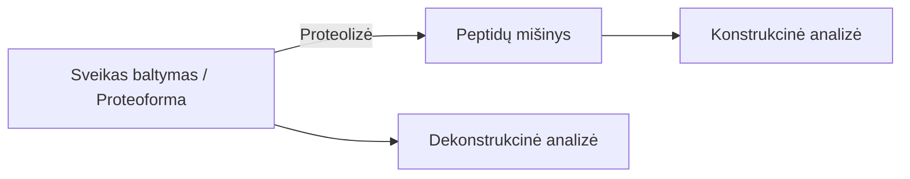

# Įvadas

Baltymo funkciją apibrėžia molekulės tridimensinė organizacija, kurią masių spektrometrija leidžia tirti visose keturiose struktūrinėse pakopose:

*   **Pirminė struktūra (Primary structure):** Aminorūgščių linijinė kovalentinė seka, po-transliacinės modifikacijos (PTM) ir disulfidiniai tilteliai.
    *   *MS taikymas:* Linijinės sekos patvirtinimas, PTM lokalizavimas bei disulfidinių jungčių kartografavimas naudojant fermentinį skaldymą arba intaktinių baltymų fragmentaciją.
*   **Antrinė struktūra (Secondary structure):** Lokaliai susidarančios $\alpha$-spiralės bei $\beta$-klostės, palaikomos polipeptidinio karkaso vandenilinių ryšių.
    *   *MS taikymas:* Vandenilio/deuterio mainų masių spektrometrija (HDX-MS), matuojanti karkaso amido vandenilių lankstumą ir apsaugą nuo tirpiklio.
*   **Tretinė struktūra (Tertiary structure):** Pilnas trimatis vienos polipeptidinės grandinės išsilankstymas erdvėje.
    *   *MS taikymas:* Kovalentinio žymėjimo (CL-MS / FPOP) bei kryžminio surišimo (XL-MS) metodai, nustatantys tirpikliui prieinamą paviršių (SASA) bei erdvinius atstumų ribojimus (*distance restraints*).
*   **Ketvirtinė struktūra (Quaternary structure):** Kelias polipeptidines grandines (subvienetus) jungiantys nekovalentiniai multimeriniai kompleksai.
    *   *MS taikymas:* Natyvioji masių spektrometrija (Native MS) bei jonų judrumo MS (IM-MS), išlaikanti nekovalentines sąveikas dujų fazėje ir nustatanti kompleksų stechiometriją bei topologiją.


**Potransliacinė modifikacija (PTM)** – tai bet koks kovalentinis baltymo cheminis pakitimas, vykstantis po to, kai jo priminė aminorūgščių grandinė būna susintetinta ribosomoje (transliacijos metu). PTM reiškinys išplečia genomo galimybes: iš vieno geno kodo sukuriama daugybė cheminiu bei funkciniu požiūriu besiskiriančių baltymo variantų – **proteoformų**. Šios modifikacijos keičia baltymo erdvinę struktūrą, stabilumą, katalizinį aktyvumą, sąveikas su kitomis molekulėmis bei išsidėstymą ląstelėje.

Priklausomai nuo tyrimo srities, dėmesys telkiamas į skirtingas PTM grupes:


##### **Potransliacinės modifikacijos biofarmacijoje**

Biofarmacijoje (gaminant vaistinius baltymus, monokloninius antikūnus ar vakcinas) PTM reiškinys analizuojamas kaip **kritiniai kokybės atributai** (angl. *Critical Quality Attributes, CQAs*) bei produkto degradacijos produktai gamybos, gryninimo, formulavimo ar saugojimo metu:

* **Glikozilinimas (Glycosylation):** Enzymatiškai pridedamos oligosacharidų grandinės prie asparagino (N-linked) arba serino/treonino (O-linked) liekanų. Glikozilinimas tiesiogiai veikia terapinių baltymų (pvz., IgG antikūnų, eritropoetino) tirpumą, pusperiodį serume, biologinį aktyvumą ir imuniteto atsaką.
* **Deamidinimas (Deamidation):** Neenziminė reakcija, kurios metu asparaginas (Asn) arba glutaminas (Gln) paverčiami rūgštinėmis formomis (aspartatu/izoaspartatu arba glutamatu). Šį procesą skatina aukštesnė temperatūra, šarminis pH ir gretimos aminorūgštys (Gly, Ser, His). Deamidinimas keičia vaisto krūvį, struktūrinį stabilumą ir prisijungimo afinitetą.
* **Oksidacija (Oxidation):** Daugiausia metionino (Met) ir triptofano (Trp), taip pat cisteino, tirozino ir histidino pažeidimas dėl deguonies, šviesos ar pagalbinių medžiagų poveikio. Metionino oksidacija skatina baltymų agregaciją ir mažina efektyvumą.
* **N- ir C-terminaliniai nukirpimai bei modifikacijos:** N-galo glutamato ciklizacija į piroglutamatą (pGlu), C-terminalinio lizino praradimas (C-lysine truncation) bei peptidinio karkaso hidrolizinis fragmentavimas.
* **Disulfidinių jungčių persitvarkymas (Disulfide scrambling):** Neteisingas S–S ryšių susidarymas, redukcija ar nepageidaujama oksidacija, iškraipanti natyvią tretinę struktūrą ir sukelianti agregaciją.


##### **Potransliacinės modifikacijos sistemų biologijoje**

Sistemų biologijoje PTM tyrinėjami siekiant suprasti **ląstelės signalinius tinklus**, genų raiškos reguliavimą, epigenetiką bei ligų patofiziologiją:

* **Fosforilinimas (Phosphorylation):** Fosfato grupės prijungimas prie Ser, Thr ar Tyr liekanų. Tai pagrindinis ląstelių signalizacijos jungiklis, keičiantis baltymų konformaciją, aktyvumą, lokalizaciją ir sąveikas ląstelės cikle bei signalo perdavimo takuose.
* **Ubikvitininimas (Ubiquitination) ir SUMOilinimas (SUMOylation):** Mažų baltyminių žymių kovalentinis prijungimas prie lizino liekanų, nukreipiantis baltymus proteasominiam skaidymui arba reguliuojantis jų atsaką į DNR pažaidas.
* **Acetilinimas ir metilinimas (Acetylation & Methylation):** Ypač aktualūs histonų modifikacijose, kur jie reguliuoja chromatinio pakavimą, genų transkripciją bei epigenetinį kodą.
* **S-tioliavimas (S-glutathionylation, S-cysteinylation):** Reaktyviųjų deguonies formų sukeliamos laisvų cisteino tiolio grupių modifikacijos, veikiančios kaip redokso būsenos jungikliai ir apsauga nuo oksidacinio streso.
* **Modifikacijų tarpusavio sąveika (PTM Crosstalk):** Reiškinys, kai viena modifikacija (pvz., fosforilinimas) skatina arba slopina kitą modifikaciją toje pačioje ar gretimose baltymo vietose, suformuojant sudėtingus ląstelinio atsako signalus.

# Masių spektrometrija struktūrinėje biologijoje

Masių spektrometriniai tyrimai skirstomi į dvi pagrindines metodologines kryptis, priklausomai nuo to, analitės būsenos patenkančios į masių spektrometrą:




| Parametras | **Konstrukcinė analizė (*Bottom-Up*)** | **Dekonstrukcinė analizė (*Top-Down*)** |
| :--- | :--- | :--- |
| **Principas** | Baltymas prieš analizę fermentiškai suskaidomas į trumpus peptidus (dažniausiai tripsinu). | Į masių spektrometrą įvedamas ir analizuojamas **sveikas, nesuskaldytas baltymas (proteoforma)**. |
| **Analitė MS analizatoriuje** | Peptidų mišinys (MS1) ir jų fragmentai (MS2). | Intaktinė proteoforma (MS1) ir jos dujų fazės fragmentai (MS2: HCD, ETD, UVPD). |
| **Privalumai** | <ul><li>Didelis jautrumas ir matavimo greitis.</li><li>Standartizuotas mėginio paruošimas ir chromatografija.</li><li>Brandūs bioinformatiniai paieškos algoritmai.</li></ul> | <ul><li>Išsaugomas pilnas PTM kontekstas ir deriniai (kombinatorinis PTM kodas).</li><li>Nėra baltymo inferencijos problemos (*no protein inference problem*).</li></ul> |
| **Trūkumai** | <ul><li>Prarandamas ryšys tarp tolimų modifikacijų.</li><li>Nepilnas sekos padengimas.</li></ul> | <ul><li>Mažesnis jautrumas dėl plataus krūvių pasiskirstymo.</li><li>Apribota baltymų mase (sudėtinga analizuoti >70 kDa).</li></ul> |

## Peptidų (ir baltymų) fragmentacijos principai

Peptido ar baltymo fragmentacija masių spektrometrijoje vyksta skeliant polipeptidinį karkasą dujų fazėje. Pagal tarptautinę **Biemann nomenklatūrą**, gauti fragmentai skirstomi į **N-terminalinius** ($a, b, c$) ir **C-terminalinius** ($x, y, z$) jonus, priklausomai nuo to, kuris peptido galas išlaiko krūvį po konkretaus karkaso ryšio skėlimo.


#### Peptidinio karkaso skėlimo vietos ir jonų struktūros

Polipeptido karkasą sudaro pasikartojanti aminorūgščių liekanų seka:

$$\dots \text{-- } \text{N-C}_\alpha \text{ -- } \text{C}_\alpha\text{-C(=O)} \text{ -- } \text{C(=O)-N(H)} \text{ -- } \text{C}_\alpha \text{ --}\dots$$

Kiekvienoje aminorūgšties liekanoje yra trys pagrindiniai karkaso kovalentiniai ryšiai, kuriuos skeliant susidaro atitinkamos jonų poros:


##### **$C_\alpha-C$ ryšio skėlimas $\rightarrow$ $a / x$ jonai**
* **$a$-jonas:** N-terminalinis fragmentas, pasibaigiantis $C_\alpha$ anglimi.
* **$x$-jonas:** C-terminalinis fragmentas, prasidedantis karbonilo grupe ($\text{O=C-}$).

##### **$C-N$ (peptidinio) ryšio skėlimas $\rightarrow$ $b / y$ jonai**
* **$b$-jonas:** N-terminalinis fragmentas, pasibaigiantis karbonilo grupe. Dujų fazėje dažnai suformuoja ciklinę **oksazolono** struktūrą.
* **$y$-jonas:** C-terminalinis fragmentas, prasidedantis laisva amino grupe ($\text{H}_2\text{N-}$), išlaikantis nepakitusį C-galą.

##### **$N-C_\alpha$ ryšio skėlimas $\rightarrow$ $c / z$ jonai**
* **$c$-jonas:** N-terminalinis fragmentas, pasibaigiantis amido grupe ($\text{-C(=O)-NH}_2$).
* **$z$-jonas:** C-terminalinis fragmentas, dažnai susidarantis kaip radikalas ($z^\bullet$), prasidedantis $C_\alpha$ anglimi.


#### Fragmentavimo metodai (HCD, ETD, UVPD) ir jonų specifiškumas

##### **HCD (Higher-energy Collisional Dissociation) $\rightarrow$ $b / y$ jonai**
* **Mechanizmas:** HCD yra **slenkstinės / vibracinės energijos metodas** (*ergodic activation*). Prekursoriaus jonai susiduria su inertinėmis dujomis (N₂, Ar), sukaupia internaliąją vibracinę energiją, kuri pasiskirsto po visą molekulę ir skelia termodinamiškai silpniausią karkaso ryšį – peptidinį **$C-N$ ryšį**.
* **Rezultatas:** Spektre dominuoja **$b$ ir $y$ jonų serijos**.
* **Ypatybė:** Dėl ergodinio energijos pasiskirstymo trapūs po-transliaciniai pakitimai (PTM, pvz., fosforilinimas) gali lengvai nukristi, o disulfidiniai tilteliai išlieka nesuskilę.

* **komentaras** Ergodinis procesas (pvz., HCD, CID): Molekulė sužadinama lėtai arba per daugkartinius susidūrimus su dujomis (vibracinis sužadinimas). Suteikta energija pasklinda po visą peptidinį karkasą3. Dėl to pirmiausia skyla termodinamiškai silpniausi ryšiai – dažniausiai nukrinta trapios po-transliacinės modifikacijos (PTM, pvz., fosfato grupės) arba suskyla mažiausios energijos reikalaujantis peptidinis $C-N$ ryšys ($b/y$ jonai)


##### **ETD (Electron Transfer Dissociation) $\rightarrow$ $c / z$ jonai**
* **Mechanizmas:** ETD yra **elektronais valdomas, neergodinis metodas**. Daugiakrūviai peptido katijonai reaguoja su mažos energijos reagentų anionais, perduodami elektroną. Šis procesas sukelia radikalinę reorientaciją, kuri specifiškai ir greitai skelia **$N-C_\alpha$ ryšį**.
* **Rezultatas:** Generuojami **$c$ ir $z^\bullet$ jonai**.
* **Ypatybė:** Kadangi fragmentacija įvyksta iki vibracinės energijos pasiskirstymo, labilios PTM ir nekovalentinės struktūros išlieka pažeistos minimaliai, todėl ETD idealiai tinka modifikacijų lokalizavimui.

* **komentaras** **Neergodinis procesas (pvz., ETD, ECD, iš dalies UVPD):** Atsiranda dėl tiesioginio elektronų pagavimo / pernašos arba aukštos energijos fotono absorbcijos[1]. Įvyksta žaibiška lokalizuota elektroninė pertvarka arba radikalo susidarymas, sukeliantis ryšio skėlimą dar iki energijos persiskirstymo po visą molekulę.

##### **UVPD (Ultraviolet Photodissociation) $\rightarrow$ $a / x$ (bei visas $a, b, c, x, y, z$ rinkinys)**
* **Mechanizmas:** UVPD metu jonai apšvitinami aukštos energijos UV fotonais (dažniausiai 193 nm arba 213 nm laserio impulsais). Elektronų sužadinimas sukelia greitą tiesioginį ryšių nutraukimą.
* **Rezultatas:** Pagrindinė būdinga jonų klasė yra **$a$ ir $x$ jonai**, tačiau UVPD sukuria itin turtingus spektrus, kuriuose stebimos **visos šešios fragmentų serijos ($a, b, c, x, y, z$)**.
* **Ypatybė:** Maža priklausomybė nuo krūvio būsenos ir labai didelis sekos padengimas (*sequence coverage*), tiriant tiek pavienius baltymus, tiek baltymų kompleksus.


| Jonų pora | Skeliamas karkaso ryšys | Fragmentavimo metodas | Metodo veikimo principas | Pagrindinis taikymas |
| :--- | :--- | :--- | :--- | :--- |
| **$b / y$** | **$C-N$** (peptidinis ryšys) | **HCD** / CID | Slenkstinis vibracinis sužadinimas per susidūrimus su dujomis | Standartinė peptidų ir proteomų seka (*bottom-up*) |
| **$c / z$** | **$N-C_\alpha$** ryšys | **ETD** / ECD | Elektronų pernaša / radikalo susidarymas (neergodinis) | PTM lokalizavimas ir intaktinių baltymų analizė (*top-down*) |
| **$a / x$** *(+ $b,c,y,z$)* | **$C_\alpha-C$** ryšys | **UVPD** (193 nm / 213 nm) | Elektroninis sužadinimas švitinant UV fotonais | Maksimalus sekos padengimas, baltymų kompleksai |


## Konstrukcinė (angl. bottom-up) analizė

Analizuojant baltymus masių spektrometrija, **„Konstrukcinė analizė“ (bottom-up)** principas yra labiausiai paplitusi strategija. Šiuo atveju sveikas baltymas yra chemiškai arba fermentiškai suskaldomas į mažesnius peptidus, kurie vėliau analizuojami naudojant skysčių chromatografiją, sujungtą su tandemine masių spektometrija (LC-MS/MS).

### Mėginio paruošimas.

Mėginio paruošimas nustato masių spektrometrijos analizės kokybės lubas: jis tiesiogiai lemia sekos padengimą (sequence coverage), peptidų jonizacijos efektyvumą ir leidžia išvengti dirbtinių cheminių modifikacijų susidarymo. Žemiau pateikiamas generinis gryno baltymo paruošimo protokolas su kiekvieno žingsnio paaiškinimu bei dažniausiai naudojamų proteazių aprašymu.

#### **Generinis bottom-up mėginio paruošimo protokolas**

##### **1. Denatūravimas (Denaturation)**
*   **Kas daroma:** Baltymas ištirpinamas suderinamame buferyje (pavyzdžiui, amonio bikarbonatinis arba Tris-HCl) ir paveikiamas stipriomis denatūruojančiomis medžiagomis – 8 M karbamidu (urea), guanidino hidrochloridu (guanidine-HCl), SDS arba masių spektrometrijai suderinamais plovikliais (pvz., RapiGest, SDC), kartais papildomai naudojant karštį.
*   **Svarba:** Šis žingsnis **išlanksto (unfolds) trimatę baltymo struktūrą**. Natūralioje būsenoje daugelis peptidinio karkaso ryšių yra paslėpti baltymo viduje. Denatūravimas padaro šiuos ryšius fiziškai prieinamus proteazei, o tai yra kritinis veiksnys siekiant maksimalaus virškinimo efektyvumo ir geros sekos aprėpties.

##### **2. Redukcija (Reduction)**
*   **Kas daroma:** Į tirpalą pridedama reduktorių, dažniausiai ditiotreitolio (DTT) arba tris(2-karboksietil)fosfino (TCEP), ir mėginys inkubuojamas (pvz., 30–60 min esant 30–60 °C temperatūrai).
*   **Svarba:** Redukavimas **suardo kovalentinius disulfidinius tiltelius (S–S ryšius)** tarp cisteino liekanų. Tai ypač svarbu disulfidais gausiai stabilizuotiems baltymams (pavyzdžiui, monokloniniams antikūnams), nes be šio žingsnio baltymas negali visiškai išsivynioti, o dalis sekos proteazei išlieka nepasiekiama.

##### **3. Alkilinimas (Alkylation)**
*   **Kas daroma:** Į redukuotą tirpalą pridedama alkilinimo agento, pavyzdžiui, jodacetamido (IAA/IAM) arba N-etilmaleimido (NEM). Reakcija vykdoma kambario temperatūroje, tamsoje, maždaug 20–60 minučių.
*   **Svarba:** Alkilavimas **kovališkai užblokuoja laisvas tiolio (-SH) grupes**. Jei šis žingsnis nebūtų atliktas, redukuoti cisteinai pH 7.5–8.5 terpėje greitai vėl suformuotų atsitiktinius disulfidinius ryšius – įvyktų disulfidų persitvarkymas (scrambling). Reakcija vykdoma tamsoje, siekiant išvengti šviesai jautraus jodacetamido skilimo ir su tuo susijusių pašalinių reakcijų. Taip pat būtina kontroliuoti alkilinimo agento koncentraciją, kad būtų išvengta nepageidaujamo kitų aminorūgščių (pvz., lizino) alkilinimo (over-alkylation).

##### **4. Buferio pakeitimas (Buffer Exchange / Dilution)**
*   **Kas daroma:** Prieš pridedant fermentą, denatūruojančių medžiagų koncentracija turi būti žymiai sumažinta. Pavyzdžiui, karbamido koncentracija turi būti mažesnė nei 2 M. Tai pasiekiama atskiedžiant mėginį virškinimo buferiu.
*   **Svarba:** Didelės denatūruojančių medžiagų koncentracijos **gali visiškai denatūruoti ir inhibuoti pačią proteazę**. Atskiedimas užtikrina optimalią aplinką proteazės aktyvumui išlaikyti.

##### **5. Fermentinis virškinimas (Enzymatic Digestion)**
*   **Kas daroma:** Įmaišoma proteazė (dažniausiai tripsinas). Įprastas fermento ir baltymo santykis svyruoja nuo $\text{1:10}$ iki $\text{1:100}$ (auksiniu standartu laikomas $\text{1:20}$ arba $\text{1:50}$). Mėginys inkubuojamas 37 °C temperatūroje tam tikrą laiką (paprastai 4–18 valandų arba per naktį). Reakcija sustabdoma parūgštinant mėginį iki pH < 3 (pridedant iki 1% skruzdžių rūgšties (HCOOH) arba trifluoracto rūgšties(TFA)).
*   **Svarba:** Proteazė **suskaldo ilgą baltymo grandinę į masių spektrometrui suderinamo dydžio peptidus** (paprastai 6–50 aminorūgščių). Virškinimo pH kontrolė yra itin svarbi: tripsinui tradiciškai naudojamas pH 8, tačiau naujesni tyrimai rodo, kad virškinimas esant pH 7 žymiai sumažina tripsino ar chimotripsinio  autolizę, be to išvengiant peptidų skilimo (dacay).

##### **6. Peptidų išvalymas ir nudruskinimas (Desalting / Cleanup)**
*   **Kas daroma:** Peptidų mišinys sulaikomas panaudojant atvirkščių fazių sorbentą (tipiškai C18). Sorbentas plaunamas vandeniu, ir peptidai eliuuojami daug organinio tirpiklio (tarkim ACN) turinčiu eliuentu. Tipiškai 80% ACN 20% 0.1%HCOOH vandenyje.
*   **Svarba:** Biolizės ir virškinimo metu naudotos nelakios druskos (pvz., NaCl, Tris), denatūrantai ir kiti reagentai stipriai slopina masių spektrometro elektropurškimo jonizacijos (ESI) signalą (ionization suppression). Nudruskinimas **pašalina tukdančias medžiagas**, palikdamas tik švarius peptidus lakiame, su masių spektrometrija suderinamame tirpiklyje.


#### **Dažniausiai naudojamos proteazės masių spektrometrijoje**

Masių spektrometrijoje proteazės pasirenkamos pagal jų kirpimo specifiškumą, aktyvumą buferiuose ir tirpumo savybes:

1.  **Tripsinas (Trypsin)**
    *   **Kirpimo vieta:** Specifiškai skelia peptidines jungtis C-terminalinėje pagrindinių aminorūgščių **lizino (Lys/K)** ir **arginino (Arg/R)** pusėje (jei po jų neseka prolinas).
    *   **Taikymas ir svarba:** Tai **dažniausiai naudojama proteazė** bottom-up proteomikoje. Tripsinas sugeneruoja optimalaus ilgio peptidus (vidutiniškai 14 aminorūgščių), kurie pasižymi teigiamu +2 krūviu teigiamos ESI masių spektrometrijos sąlygose (dėl C-terminalinio K/R ir N-terminus), o tai užtikrina puikų aptikimą ir lengvą fragmentaciją.

2.  **Lys-C**
    *   **Kirpimo vieta:** Specifiškai skelia tik po **lizino (Lys/K)** liekanų (gali skelti net jei po lizino seka prolinas).
    *   **Taikymas ir svarba:** Lys-C yra itin atsparus denatūrantams (gali išlaikyti aktyvumą net esant 2 M guanidino HCl). Dažnai naudojamas etapiniam (staged) arba kombinuotam virškinimui su tripsinu (Lys-C/trypsin), siekiant maksimaliai suvirškinti itin tankius, sunkiai prieinamus baltymus.

3.  **Asp-N**
    *   **Kirpimo vieta:** Specifiškai skelia N-terminalinėje pusėje prieš **aspartato (Asp/D)** (ir kartais glutamato (Glu/E)) liekanas.
    *   **Taikymas ir svarba:** Naudojamas kaip papildomas fermentas tripsino „aklosioms dėmėms“ padengti arba analizuojant specifines modifikacijas (pavyzdžiui, glikozilinimą ar vaistų prisijungimo vietas biopreparatuose).

4.  **Pepsinas (Pepsin)**
    *   **Kirpimo vieta:** Pasižymi platesniu, nespecifiniu kirpimu (daugiausia po hidrofobinių ir aromatinių liekanų).
    *   **Taikymas ir svarba:** Pepsinas yra išskirtinis tuo, kad **veikia itin rūgščioje terpėje (pH 1.3–2.5)**. Tai yra pagrindinis fermentas **vandenilio-deuterio mainų (HDX-MS)** tyrimuose, kur parūgštinimas ir žema temperatūra (gesinimo sąlygos) yra būtinos siekiant išvengti deuterio praradimo. Taip pat pepsinas plačiai taikomas disulfidinių tiltelių žemėlapių sudarymui, nes rūgštus pH užkerta kelią disulfidų persitvarkymui.

5.  **Chymotripsinas (Chymotrypsin)**
    *   **Kirpimo vieta:** Skelia C-terminalinėje **aromatinių ir hidrofobinių liekanų** – tirozino (Tyr/Y), fenilalanino (Phe/F), triptofano (Trp/W) bei, kiek lėčiau, leucino (Leu/L) ir metionino (Met/M) – pusėje.
    *   **Taikymas ir svarba:** Naudojamas kaip alternatyvus fermentas hidrofobinių membraninių baltymų sričių analizėje arba kai tripsinas sugeneruoja per didelius ar per mažus fragmentus.

### De-Novo peptidų sekvenavimas

#### Instrumentinė DDA analizė

**De Novo sekvenavimui** DDA (*Data-Dependent Acquisition*) parametrai optimizuojami vienam tikslui – gauti **kuo švaresnį, didelės skiriamosios gebos MS/MS spektrą su kiek įmanoma daugiau diagnostinių fragmementų**:

1. **Siauras izoliacijos langas (0.5–1.0 Da):** Užtikrina vieno prekursoriaus izoliavimą ir užkerta kelią chimerinių spektrų susidarymui.
2. **Didelė MS2 skiriamoji geba (60 000–120 000+) ir masės tikslumas (<10 ppm):** Būtini tiksliam izotopinių klasterių išskleidimui, krūvių nustatymui bei masių skirtumų skaičiavimui.
3. **Padidintas signalo akumuliavimas (aukštas AGC target ir Max Inject Time):** Pakelia signalo ir triukšmo santykį $S/N$, išryškindamas silpnus karkaso fragmentus.
4. **Aukštesnio krūvio atranka $z \ge +2$, optimalu $z \ge +3$:** Atrenkami geriau ir įvairiapusiškiau fragmentuojantys prekursoriai.
5. **Komplementarios fragmentacijos strategija (Stepped HCD, ETD/EThcD arba UVPD):** Generuoja kelias fragmentų serijas $b/y$, $c/z$, $a/x$, užpildančias sekos spragas.
6. **Trumpas dinaminio atmetimo sąrašo (DEW) galiojimas:** Leidžia taikyti pakartotinį skenavimą / spektrų vidurkinimą silpniems fragmentams sustiprinti.

#### Duomenų analizė

Tegul peptidas $P$ yra aminorūgščių liekanų seka iš $N$ elementų: $$P = [a_1, a_2, \dots, a_N]$$

Čia $m(aa_ri)$ yra $i$-osios aminorūgšties liekanos monoisotopinė masė ($a_i \in \mathcal{A}$, kur $\mathcal{A}$ – 20 standartinių aminorūgščių masių aibė).

Protono masė: $m(\text{H}^+) \approx 1{,}0073\ \text{Da}$

Vandens masė: $m(\text{H}_2\text{O}) \approx 18{,}0106\ \text{Da}$

Prekursoriaus jono masė ($M_{\text{prec}}$): 

$$M_{\text{prec}} = [M+\text{H}]^+ = \sum_{i=1}^N m(a_i) + m(\text{H}_2\text{O}) + m(\text{H}^+)$$


| Liekana       | Ilgas Žymuo | Trumpas Žymuo | Liekanos masė($\text{m(AA)}_{r}$) | $\text{b}_{1}$ jonas | $\text{y}_{1}$ jonas | $\text{b}_{n-1}$ jonas |
|---------------|-------------|---------------|-----------------------------------|----------------------|----------------------|------------------------|
| Alanine       | Ala         | A             | 71.0371                           | 72.0444              | 90.055               | 54.0338                |
| Cysteine      | Cys         | C             | 102.0014                          | 103.0086             | 121.0192             | 84.9981                |
| Asp.acid      | Asp         | D             | 115.0269                          | 116.0342             | 134.0448             | 98.0237                |
| Glu.acid      | Glu         | E             | 129.0426                          | 130.0499             | 148.0604             | 112.0393               |
| Phenylalanine | Phe         | F             | 147.0684                          | 148.0757             | 166.0863             | 130.0651               |
| Glycine       | Gly         | G             | 57.0215                           | 58.0287              | 76.0393              | 40.0182                |
| Histidine     | His         | H             | 137.0589                          | 138.0662             | 156.0768             | 120.0556               |
| Isoleucine    | Ile         | I             | 113.0841                          | 114.0913             | 132.1019             | 96.0808                |
| Lysine        | Lys         | K             | 128.095                           | 129.1022             | 147.1128             | 111.0917               |
| Leucine       | Leu         | L             | 113.0841                          | 114.0913             | 132.1019             | 96.0808                |
| Methionine    | Met         | M             | 131.0405                          | 132.0478             | 150.0583             | 114.0372               |
| Asparagine    | Asn         | N             | 114.0429                          | 115.0502             | 133.0608             | 97.0396                |
| Proline       | Pro         | P             | 97.0528                           | 98.06                | 116.0706             | 80.0495                |
| Glutamine     | Gln         | Q             | 128.0586                          | 129.0659             | 147.0764             | 111.0553               |
| Arginine      | Arg         | R             | 156.1011                          | 157.1084             | 175.119              | 139.0978               |
| Serine        | Ser         | S             | 87.032                            | 88.0393              | 106.0499             | 70.0287                |
| Threonine     | Thr         | T             | 101.0477                          | 102.055              | 120.0655             | 84.0444                |
| Valine        | Val         | V             | 99.0684                           | 100.0757             | 118.0863             | 82.0651                |
| Tryptophan    | Trp         | W             | 186.0793                          | 187.0866             | 205.0972             | 169.076                |
| Tyrosine      | Tyr         | Y             | 163.0633                          | 164.0706             | 182.0812             | 146.06                 |


#### Algoritmas 1: N-terminalinis sekvenavimas

Algoritmas atlieka paiešką masių spektro smailių rinkinyje $\mathcal{S} = \{m/z_1, m/z_2, \dots\}$, judėdamas nuo N-galo ($0\ m/z$) link prekursoriaus masės $M_{\text{prec}}$

##### Atskaitos taško nustatymas bei pirminių jonų ($b_1$ ir $y_1$) paieška

Atskaitos bazinė būsena ($b_0, y_0$): 

$$m/z(b_0) = m(\text{H}^+) \approx 1{,}0073\ \text{Da} \quad (\text{atitinka } 0\ \text{Da neutralioje skalėje})$$

$$m/z(y_0) = m(\text{H}_2\text{O}) + m(\text{H}^+) =  19{,}0224$$

###### $b_1$ jono paieška ir atitinkama seka: 

* **Matematinė sąlyga**: Ieškoma smailės $m/z \in \mathcal{S}$, tenkinančio lygtį:

$$m/z(b_1) = m/z(b_0) + m(AA_{r1}) \pm \varepsilon = m(\text{H}^+) + m(AA_{r1}) \pm \varepsilon$$ 

(kur $\varepsilon$ – spektrometro masių paklaida, pvz., ppm arba Da).
* **Atitinkanti seka**: $b_1$ jonas atitinka N-terminalinį monopeptidą $P_{1..1} = [a_1]$.

###### $y_1$ jono paieška ir atitinkama seka:
* **Matematinė sąlyga**: C-terminalinis pirminis fragmentas tenkina lygtį: 

$$m/z(y_1) = m(AA_{rN}) + m(\text{H}_2\text{O}) + m(\text{H}^+) \approx m(AA_{rN}) + 19{,}0224\ \text{Da}$$

(Tripsino proteolizės atveju $a_N \in \{\text{Lys}, \text{Arg}\}$, todėl $m/z(y_1) \in \{147{,}1129\ \text{Da}, 175{,}1190\ \text{Da}\}$).

* **Atitinkanti seka**: $y_1$ jonas atitinka C-terminalinį monopeptidą $P_{N..N} = [a_N]$.


##### Rekursinė jonų serijų paieška ($b_k$ ir $y_k$)

Žinant $(k-1)$-ąją būseną, $k$-ojo jono paieška vykdoma pagal rekursines priklausomybes:

######  $b_k$ jonų serijos auginimas ($N \rightarrow C$ kryptimi):

* **Rekursija**: $m/z(b_k) = m/z(b_{k-1}) + m(AA_{rk}) \pm \varepsilon$

* **Atitinkanti seka**: Jonas $b_k$ atitinka N-terminalinį sub-peptidą $P_{1..k} = [a_1, a_2, \dots, a_k]$.

###### $y_k$ jonų serijos auginimas ($C \rightarrow N$ kryptimi):

* **Rekursija**: $m/z(y_k) = m/z(y_{k-1}) + m(AA_{r(N-k+1)}) \pm \varepsilon$

* **Atitinkanti seka**: Jonas $y_k$ atitinka C-terminalinį $k$ ilgio peptidą $P_{(N-k+1)..N} = [a_{N-k+1}, \dots, a_N]$.

##### Algoritmo užbaigimo sąlyga

Paieška sėkmingai baigiama, kai pasiekiamas paskutinis $b_N, y_N$ jonai, tenkinantys sąlygą: 

$$m/z(b_N) + m(\text{H}_2\text{O}) = M_{\text{prec}} \implies \sum_{i=1}^N m(AA_{ri}) + m(\text{H}^+) + m(\text{H}_2\text{O}) = M_{\text{prec}}$$

$$m/z(y_N) = \sum_{i=1}^{N} m(AA_i) + m(\text{H}_2\text{O}) + m(\text{H}^+) = M_{\text{prec}}$$


#### Algoritmas 2: C-terminalinis sekvenavimas

Algoritmas atlieka paiešką masių spektro pikų rinkinyje $\mathcal{S}$, judėdamas nuo prekursoriaus masės $M_{\text{prec}}$ žemyn link bazinių taškų ($y_0$ ir $b_0$).

##### Pirminių sub-fragmentų ($y_{N-1}$ ir $b_{N-1}$) nustatymas
###### $y_{N-1}$ jono paieška (N-terminalinės pirmosios aminorūgšties $a_1$ atskėlimas):

* **Matematinė sąlyga**: Atėmus N-galinės aminorūgšties masę $m(AA_{r1})$ tiesiai iš prekursoriaus, gaunama teorinė $y_{N-1}$ jono masė:

$$m/z(y_{N-1}) = M_{\text{prec}} - m(AA_{r1}) \pm \varepsilon$$

* **Atitinkanti seka**: Jonas $y_{N-1}$ atitinka C-terminalinį $(N-1)$ ilgio sufiksą $P_{2..N} = [a_2, a_3, \dots, a_N]$.

###### $b_{N-1}$ jono paieška (C-terminalinės paskutiniosios aminorūgšties $a_N$ atskėlimas):

* **Matematinė sąlyga**: Atėmus C-galinę aminorūgštį $m(a_N)$ bei C-terminalinį vandens likutį $m(\text{H}_2\text{O})$, gaunama N-terminalinė fragmento masė: 

$$m/z(b_{N-1}) = M_{\text{prec}} - m(AA_{rN}) - m(\text{H}_2\text{O}) \pm \varepsilon \approx M_{\text{prec}} - m(a_N) - 18{,}0106\ \text{Da}$$

* **Atitinkama seka**: Jonas $b_{N-1}$ atitinka N-terminalinį prefiksą $P_{1..N-1} = [a_1, a_2, \dots, a_{N-1}]$.

##### Rekursinė jonų serijų paieška
Žinant aukštesniojo lygmens fragmentą, žemesniojo lygmens fragmentų ieškoma atimant atitinkamas aminorūgščių mases:
###### $y$-serijos dekonstrukcija (mažėjančio $m/z$ kryptimi):

* **Rekursija**: Ieškoma smailės $m/z(y_{N-k}) \in \mathcal{S}$, tenkinančio sąlygą: 

$$m/z(y_{N-k}) = m/z(y_{N-k+1}) - m(AA_{rk}) \pm \varepsilon$$

* **Atitinkama seka**: Jonas $y_{N-k}$ atitinka sufiksą $P_{(k+1)..N} = [a_{k+1}, \dots, a_N]$.

###### $b$-serijos dekonstrukcija (mažėjančio $m/z$ kryptimi):
Prekursorių atitinkantis N-galinis viršutinis taškas yra $m/z(b_N) = M_{\text{prec}} - m(\text{H}_2\text{O}) \approx M_{\text{prec}} - 18{,}0151\ \text{Da}$.
* **Rekursija**: 

$$m/z(b_{N-k}) = m/z(b_{N-k+1}) - m(AA_{r(N-k+1)}) \pm \varepsilon$$

* **Atitinkama seka**: Jonas $b_{N-k}$ atitinka prefiksą $P_{1..(N-k)} = [a_1, \dots, a_{N-k}]$.

##### Algoritmo užbaigimo sąlygos
Paieška atimant mases baigiama, kai pasiekiami atitinkami baziniai jonai:
* $y$-serijos užbaigimo sąlyga: Paieška sėkmingai baigiama pasiekus bazinį C-galinį tašką $y_0$: 

$$m/z(y_1) - m(AA_{rN}) = m/z(y_0) = m(\text{H}_2\text{O}) + m(\text{H}^+) \approx 19{,}0224\ \text{Da}$$

* $b$-serijos užbaigimo sąlyga: Paieška sėkmingai baigiama pasiekus bazinį N-galinį tašką $b_0$: 

$$m/z(b_1) - m(AA_{r1}) = m/z(b_0) = m(\text{H}^+) \approx 1{,}0073\ \text{Da}$$


#### De-Novo sekvenavimo kokybės kontrolė

Peptidų **_de novo_ sekvenavimo** ir masių spektrometrijos duomenų kokybės kontrolė (angl. *Quality Control, QC*) yra esminis žingsnis, nes kitaip nei ieškant žinomose duomenų bazėse, čia seka konstruojama be išankstinio šablono, todėl kyla didesnė klaidingai teigiamų atitikmenų (*False Positives*) rizika.

Kokybės kontrolė vykdoma keliais lygmenimis: **metriniu/skaitmeniniu**, **spektriniu/verifikaciniu** ir **eksperimentiniu**.


##### Skaitmeninės ir algoritminės metrikos

* **Lokalusis aminorūgščių patikimumo įvertis (Position-wise / ALC Score):**
  * Modernūs _de novo_ algoritmai (pvz., *PEAKS*, *DeepNovo*) kiekvienai nustatytai aminorūgščiai sekoje apskaičiuoja individualų patikimumo įvertį (0–100% arba ALC – *Average Local Confidence*).
  * **Aukštas patikimumas (>80–90%):** Aminorūgštis patvirtinta abiejų krypčių $b$ ir $y$ ryškiomis smailėmis.
  * **Žemas patikimumas (<50%):** Aminorūgšties vietoje trūksta smailių (vyksta dipeptidinis šuolis) arba smailės intensyvumas yra artimas triukšmui.

* **Karkaso ryšių padengimas (% Sequence / Bond Coverage):**
  * Apskaičiuojamas stebimų fragmentinių ryšių santykis su visu galimu peptido karkaso ryšių skaičiumi:
  
    $$\text{Sekos padengimas (\%)} = \frac{\text{Aminorūgštys, patvirtintos fragmentiniais jonais}}{\text{Bendras aminorūgščių skaičius sekoje}} \times 100$$
    
  * Jei fragmentacijos spektre patvirtinta $\ge \text{80–90}\%$ karkaso jungčių, sekos patikimumas laikomas aukštu.

* **Prekursoriaus ir fragmentų masių tikslumas (Mass Accuracy, ppm):**
  * **Prekursoriaus masės nuokrypis:** Sukonstruotos sekos teorinė masė $\sum M(AA_i) + M(\text{H}_2\text{O}) + H^+$ turi atitikti išmatuotą prekursoriaus $[M+H]^+$ masę. Šiuolaikiniams Orbitrap / FT-ICR prietaisams reikalaujama **$\le 10\text{ ppm}$**, o Q-TOF prietaisams – **$\le 20\text{ ppm}$** masių paklaidos.
  * **Fragmentų masės nuokrypis:** Kiekvienas spektre priskirtas  $b$ ar $y$ jonas turi patekti į griežtą masių tolerancijos langą (pvz., $\le 10–15\text{ ppm}$.


##### Spektriniai ir cheminiai verifikavimo požymiai

* **Neutralių praradimų ir izotopinių profilių patikra:**
  * Patikrinama, ar stebimi diagnostiniai neutralių praradimų smailės $y - \text{H}_2\text{O}$, $y - \text{NH}_3$, $b - \text{H}_2\text{O}$.
  * Tikrinamas izotopinio klasterio pasiskirstymas (angl. *isotopic envelope fit*) – ar eksperimentinis izotopų intensyvumas atitinka teorinį atitinkamos masės peptido izotopinį pasiskirstymą.

* **Isobarinių aminorūgščių atskyrimas:**
  * **Leucinas (Leu) ir Izoleucinas (Ile):** Jų monoisotopinė masė yra identiška $113{,}0840\text{ Da}$. Standartiniame HCD/CID spektre jų atskirti neįmanoma (nebent taikoma šoninių fragmentacija su UVPD arba EThcD).
  * **Glutaminas (Gln, 128.0586 Da) vs Lizinas (Lys, 128.0949 Da):** Skirtumas yra tik $0{,}036\text{ Da}$ (36 mDa). Kokybės kontrolei būtina užtikrinti aukštą masių skiriamąją gebą, kad šie likučiai nebūtų supainioti.


##### Eksperimentiniai ir statistiniai kokybės kontrolės metodai

* **Dviejų komplementarių fragmentavimo metodų apjungimas (Dual Dissociation):**
  * HCD/CID (generuoja $b/y$ jonus) apjungimas su **ETD, EThcD arba UVPD** (generuoja $c/z$ ir $a/x$ jonus) užtikrina komplementarią informaciją ir padidina sekos padengimą bei patikimumą iki $\ge 90\%$.

* **Perdengiančių peptidų strategija (Overlapping Peptides):**
  * Naudojant skirtingas proteazes (pvz., Tripsinas + Asp-N + Chimotrypsinas) gaunami perdengiantys peptidai. Jei ta pati seka nustatoma keliuose skirtinguose fragmentuose, patikimumas išauga kelis kartus.

* **Target-Decoy ir Entrapment kontrolė (FDR estimation):**
  * Kai _de novo_ rezultatai vertinami proteomų mastu, taikomi **Target-Decoy** (su apverstomis sekų duomenų bazėmis) arba **Entrapment** (įmaišant žinomų svetimų organizmų sekas) algoritmai, leidžiantys apskaičiuoti klaidingų atradimų dažnį **FDR $\le 1\%$**) spektro (CSM) ir peptido lygmenyse.


### Peptidų žemėlapio (peptide mapping) analizė.


**Peptidų žemėlapio analizė** (*Peptide Mapping*) yra vienas svarbiausių ir plačiausiai taikomų masių spektrometrijos (*Bottom-Up* LC-MS/MS) metodų biofarmacijoje ir baltymų chemijoje. Pagrindinis šio metodo tikslas – fermentiškai suskaidyti gryną baltymą į specifinius peptidų fragmentus ir juos chromatografiškai bei masių spektrometriškai charakterizuoti.

##### Pagrindiniai taikymai ir uždaviniai:
1. **Pirminės struktūros ir sekos patvirtinimas (100% Sequence Coverage):**
   * Patvirtinama, kad rekombinantinio baltymo (pvz., monokloninio antikūno, mAB) aminorūgščių seka atitinka genetinį kodą.
2. **Kritinių kokybės atributų (CQA / PQA) charakterizavimas:**
   * Rekombinantiniai bioterapiniai baltymai yra gaminami ląstelių kultūrose, todėl pasižymi mikroheterogeniškumu. Peptidų žemėlapis leidžia kiekybiškai įvertinti produkte esančias modifikacijas.
3. **Po-transliacinių modifikacijų (PTM) aptikimas ir lokalizavimas:**
   * N-glikozilinimas (konsensuso seka Asn-X-Ser/Thr), deamidinimas (Asn $\rightarrow$ Asp/isoAsp), oksidacija (Met, Trp), N-galinis piroglutamato susidarymas, C-galinio lizino nukirpimas bei proteoliziniai trūkiai (*clippings*).
4. **Disulfidinių tiltelių nustatymas (Disulfide Mapping):**
   * Atliekant peptidų žemėlapio analizę **neredukuojančiomis sąlygomis**, išlaikomos natūralios disulfidinės $S-S$ jungtys tarp Cys likučių, leidžiančios patvirtinti teisingą baltymo tretinę struktūrą ir nustatyti nepageidaujamą disulfidų persitvarkymą (*scrambling*).


#### Instrumentinės DDA (Data-Dependent Acquisition) sąlygos

Duomenimis valdomas nuskaitymas (**DDA**) yra standartinis peptidų žemėlapio analizės režimas. Skaitmeninimo ciklo metu masės spektrometras atlieka pilną MS1 nuskaitymą (*Survey Scan*), iš jo automatiškai atrenka $N$ intensyviausių prekursorių jonų ir juos iš eilės izoliuoja bei fragmentuoja MS2 spektruose.

##### Optimalūs DDA parametrai peptidų žemėlapio analizei:

| DDA Parametras | Rekomenduojama reikšmė | Techninis pagrindimas |
| :--- | :--- | :--- |
| **Krūvio būsenos filtras** | $z = +2 \dots +6$ | Atmetami vienkrūviai ($z=+1$) fono pikai ir nepeptidinės triukšmo junginiai. |
| **Izoliacijos langas** | $1.2 \dots 2.0\text{ Da}$ (arba Th) | Užtikrina pakankamą jonų srautą silpniems modifikuotiems peptidams aptikti. |
| **Dinaminė išskyra** | $15 \dots 30\text{ s}$ | Neleidžia prietaisui pakartotinai fragmentuoti tų pačių dominantinių peptidų, leisdamas aptikti mažo intensyvumo PTM. |
| **TopN atranka** | Top $10 \dots 20$ | Subalansuoja chromatografinio piko plotį ir MS2 spektrų skaičių per piko ištekėjimo laiką. |
| **MS1 Skiriamoji geba** | $60,000 \dots 120,000$ (ties $m/z\ 200$) | Būtina tiksliam prekursorių monoisotopinės masės ir izotopinio klasterio nustatymui. |
| **MS2 Skiriamoji geba** | $15,000 \dots 30,000$ (arba $60,000$) | Užtikrina pakankamą fragmentų $b/y$ jonų masių tikslumą ($\le 10\text{ ppm}$) ir greitą skaitmeninimą. |
| **AGC Target & Injection Time** | MS1: $3 \times 10^6$, MS2: $1 \times 10^5$; Max IT: $50 \dots 100\text{ ms}$ | Užkerta kelią jonų pertekliui (*space charge effects*) Orbitrap analizatoriuje. |
| **Fragmentacija (HCD)** | Normalizuota susidūrimo energija (NCE) $28 \dots 30\%$ | Užtikrina tolygų peptidinio $C-N$ ryšio skėlimą generuojant $b$ ir $y$ jonų serijas. |


#### Peptidų atpažinimas ir Peptido-Spektro Atitikmuo (PSM)

Gauti eksperimentiniai LC-MS/MS duomenys analizuojami naudojant specializuotus paieškos variklius (*Mascot*, *Sequest*, *Byonic*, *MS Amanda*, *PEAKS*).

##### PSM identifikavimo eiga:
1. **In silico baltymų duomenų bazės virškinimas:**
   * Programinė įranga virtualiai sukarpo baltymo seką pagal naudotos proteazės specifiškumą
   * Generuojami teoriniai peptidų karkaso fragmentų ($b$ ir $y$ jonų) spektrai.
2. **Eksperimentinio spektro lyginimas su teoriniu (PSM - Peptide-Spectrum Match):**
   * Kiekvienas eksperimentinis MS/MS spektras lyginamas su teoriniais peptidais, patekančiais į prekursoriaus masės tolerancijos langą ($\pm 10\text{ ppm}$).
3. **Atitikties įvertis (Scoring Function):**
   * Įvertis apskaičiuojamas atsižvelgiant į:
     * Sutampančių $b$ ir $y$ jonų skaičių ir masių tikslumą (ppm).
     * Santykinį atitinkančių pikų intensyvumą spektre.
     * Nepriskirtų (triukšmo) pikų dalį.


#### Kokybės kontrolė: Klaidingo atradimo faktorius (FDR)

Ieškant didelėse masių duomenų erdvėse arba įtraukus daug galimų PTM modifikacijų, išauga rizika gauti klaidingai teigiamus peptidų atitikmenis (*False Positives*). Kokybės kontrolei taikoma **Target-Decoy** paieškos strategija.

##### Target-Decoy metodas ir formulė:
* Kartu su tikrąja baltymo seka (*Target*) į paieškos duomenų bazę įtraukiama apversta arba sumaišyta seka (*Decoy*).
* Visi atitikmenys, užfiksuoti su *Decoy* seka, laikomi matematiškai garantuotais klaidingais teigiamais atitikmenimis ($FP$).

**FDR skaičiavimo formulė:**
$$\text{FDR} = \frac{N_{\text{decoy}}}{N_{\text{target}}}$$

arba konservatyvesnė santykinė forma:
$$\text{FDR} = \frac{2 \times N_{\text{decoy}}}{N_{\text{target}} + N_{\text{decoy}}}$$

##### Hierarchiniai FDR lygmenys:
1. **PSM / CSM lygmuo:** Klaidingų spektrų atitikmenų dažnis (standartas: $\le 1\%$).
2. **Peptido lygmuo:** Unikalių peptidų sekų klaidingo nustatymo dažnis (apsaugo nuo to paties klaidingo peptido daugybinio skaičiavimo).
3. **Baltymo lygmuo:** Baltymų identifikavimo tikslumas proteomikos tyrimuose.


#### PTM atradimas ir MAM (Multi-Attribute Method) biofarmacijoje

**MAM (Multi-Attribute Method)** yra Amgen 2015 m. pristatyta novatoriška LC-MS metodologija, skirta pakeisti kelis tradicinius kokybės kontrolės (QC) testus (tokius kaip IEX chromatografija, HILIC, CE-SDS) vienu visapusišku MS analiziniu tyrimu.

```
┌────────────────────────────────────────────────────────────────────────┐
│                        1. CHARAKTERIZAVIMO ETAPAS                      │
│  Gilus LC-MS/MS DDA Peptidų Žemėlapis ──> CQA/PQA Nustatymas & Hotspots  │
└───────────────────────────────────┬────────────────────────────────────┘
                                    │
                                    ▼
┌────────────────────────────────────────────────────────────────────────┐
│                          2. STEBĖSENOS ETAPAS                          │
│  Tikslinė MS1 EIC Quantitation + Naujų Pikų Aptikimas (New Peak Detection)│
└────────────────────────────────────────────────────────────────────────┘
```

#### Dviejų pakopų MAM procesas:

1. **Charakterizavimo etapas (*Characterization Stage*):**
   * Atliekama gili LC-MS/MS DDA peptidų žemėlapio analizė su aukštos skiriamosios gebos masės spektrometru.
   * Identifikuojamos visos produkte esančios modifikacijos (glikozilinimo profilis, deamidinimas, oksidacija) ir nustatomi **CQA karštieji taškai (*hot-spots*)**.
   * Apibrėžiami tiksliniai peptidai, jų sulaikymo trukmės (RT) ir prekursorių $[M+nH]^{n+}  $m/z$ reikšmės.

2. **Stabilios stebėsenos etapas (*Monitoring Stage*):**
   * Rurininėje biofarmacinio produkto kokybės kontrolės aplinkoje vykdoma **tik MS1 EIC (*Extracted Ion Chromatogram*)** analizė be privalomo MS/MS fragmentavimo.
   * Automatizuotai apskaičiuojamas kiekvieno modifikuoto peptido santykinis kiekis (%):
     $$\%\text{ Modifikacijos} = \frac{\text{AUC}(\text{Modifikuotas peptidas})}{\text{AUC}(\text{Modifikuotas}) + \text{AUC}(\text{Nemodifikuotas peptidas})} \times 100\%$$

3. **Naujų smailių aptikimas (*New Peak Detection - NPD*):**
   * Lyginant tiriamo mėginio MS1 chromatogramą su etaloninu (*Reference Standard*), algoritmas automatiškai signalizuoja apie bet kokią **naują neidentifikuotą smailę** arba smailės mases nuokrypį, Viršijantį nustatytą slenkstį.

#### Reguliatyvinis ir cGMP atitikimas:
MAM programinė įranga (*Thermo Scientific Chromeleon / BioPharma Finder*, *Waters UNIFI*, *Byos*) atitinka **FDA 21 CFR Part 11** bei **EU Annex 11** reikalavimus (duomenų vientisumas, audito pėdsakai, elektroniniai parašai), todėl MAM sėkmingai diegiamas cGMP vaistų gamybos ir išleidimo (Release & Stability Testing) laboratorijose.
